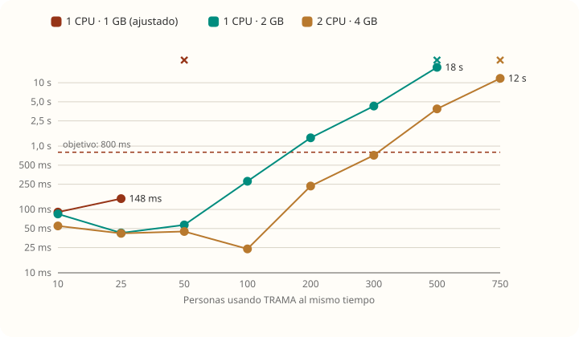
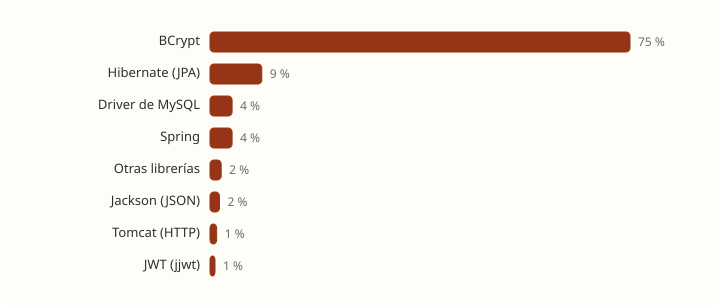
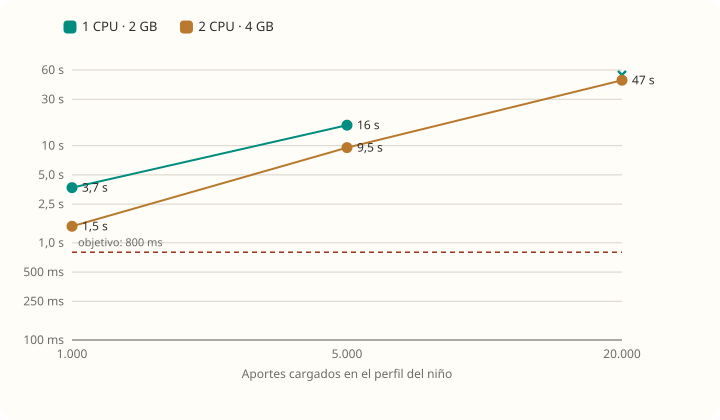

# Pruebas de carga, capacidad y seguridad de TRAMA

> **Estado:** pruebas hechas el 5 y 6 de noviembre de 2026 sobre `develop` (backend con Spring Boot 3.1.11), en una Mac con Docker. Ningún dato es real: se usaron 200 familias inventadas (`familiaN@prueba.trama.test`).
> El entorno de pruebas vive **fuera del repo** y no modifica código, migraciones ni el `docker-compose.yml`.

## Para qué sirve este informe

Para decidir **qué servidor pagar**, saber **cuánto aguanta TRAMA hoy**, **qué la satura exactamente** y **qué arreglar primero** antes de salir a producción.

| Documento | Qué tiene |
|---|---|
| Este archivo | Resumen, conclusiones y prioridades |
| [metodologia.md](metodologia.md) | **Cómo testeamos:** entorno, simulación de servidores, cada prueba paso a paso, herramientas y límites |
| [rendimiento.md](rendimiento.md) | Techo de cada servidor, qué lo satura, costo de cada flujo, prueba larga, resiliencia |
| [casos-limite.md](casos-limite.md) | Niños con miles de aportes, ediciones simultáneas, archivos, tormenta de logins, disco lleno |
| [capacidad-50gb.md](capacidad-50gb.md) | Cuánto ocupa cada cosa y cuánto entra en un disco de 50 GB |
| [seguridad.md](seguridad.md) | Vulnerabilidades del código, la configuración y las dependencias |
| [escalabilidad.md](escalabilidad.md) | Qué tan escalable es TRAMA, por qué no lo es en lo que no lo es y cómo podría serlo |
| [remediacion.md](remediacion.md) | Cómo arreglar cada vulnerabilidad, en tres etapas, y cómo verificar que quedó arreglada |

## Respuestas cortas

**¿Qué servidor conviene?** Un **VPS de 1 CPU y 2 GB** alcanza para empezar, siempre que se arreglen los puntos de la tabla de prioridades. El de **1 GB no sirve**: con el compose actual MySQL ni siquiera arranca, y ajustado se cae con 50 personas. El de **2 CPU y 4 GB** da cerca del doble de techo, pero no resuelve los problemas de diseño.

| Servidor | ¿Arranca? | Techo medido (pedidos/s) | p95 con 100 personas | Veredicto |
|---|---|---|---|---|
| 1 CPU · 1 GB (compose actual) | ❌ MySQL muere por memoria al iniciar | — | — | No sirve |
| 1 CPU · 1 GB (ajustado) | ✅ | se cae con 50 personas (sin memoria) | — | No sirve |
| 1 CPU · 2 GB | ✅ | **118** (con re-logins) · **162** (login una vez) | 279 ms · 186 ms | Alcanza para empezar |
| 2 CPU · 4 GB | ✅ | **196** (con re-logins) · **282** (login una vez) | 24 ms · 14 ms | Holgado; mismos límites de diseño |

**¿Qué satura a TRAMA?** Una cadena de tres eslabones (detalle en [rendimiento.md](rendimiento.md#qué-satura-a-trama)):

1. **BCrypt** (la verificación de contraseñas) se come entre el **57 % y el 78 % de la CPU** cuando hay logins.
2. Por **Open Session In View** (activado por defecto en Spring y no desactivado en TRAMA), el login **retiene una de las 10 conexiones a la base mientras calcula BCrypt**.
3. Con la CPU ocupada, las 10 conexiones se agotan y **todos los pedidos hacen cola** hasta 30 s. En un minuto de saturación los hilos sumaron **10.671 segundos esperando una conexión**.

En segundo plano: el **filtro JWT** (11 % a 24 % de la CPU de cada pedido: valida el token tres veces y busca al usuario en la base) y unas **27 consultas SQL por pedido** (N+1 en adjuntos y permisos repetidos). **MySQL no es el cuello de botella**: ninguna consulta pasó de 0,2 ms en promedio.

**¿Cuál es el límite real?** **No es la cantidad de usuarios ni el disco: es cuántos aportes tiene cada niño.** La lista de aportes no tiene paginación. Con **1.000 aportes por niño** (menos de un año de uso activo), abrir un perfil tarda **3,7 s** en 1 CPU · 2 GB con 20 personas mirando. Con 200.000 aportes en la base (unos 1.000 por niño), la misma carga que antes respondía en 279 ms pasa a **15,3 s**. Ver [casos-limite.md](casos-limite.md#niños-con-muchos-aportes).

**¿Cuánto entra en 50 GB?** Con los supuestos de uso de [capacidad-50gb.md](capacidad-50gb.md), quedan unos **30 GB útiles** para datos. Cada niño ocupa unos **26 MB por año**, el 93 % por archivos adjuntos. Eso da para **~1.150 niño-años** (por ejemplo, 575 niños durante 2 años) **si los backups van a otro lado**. Con 7 backups diarios en el mismo disco baja a **~150 niño-años**, porque cada backup copia **todos** los adjuntos y el script actual **no borra backups viejos**.

## Hallazgos y prioridades

Ordenados por impacto. Cada uno tiene la evidencia en el documento que se indica.

| # | Hallazgo | Impacto | Dónde |
|---|---|---|---|
| 1 | La lista de aportes y la bitácora traen **todo** sin paginar, con una consulta extra por aporte (N+1 de adjuntos) y descifrando cada texto | Con ~1.000 aportes por niño la app se vuelve lenta; con 20.000 deja de responder | [casos-limite.md](casos-limite.md#niños-con-muchos-aportes) |
| 2 | **Subidas y descargas fallan con `500` después de un pico de uso**: `ArchivoService` lee y escribe cada archivo entero y Java agota la *memoria directa* | Entre 26 % y 75 % de subidas fallidas hasta reiniciar | [casos-limite.md](casos-limite.md#archivos-adjuntos) |
| 3 | **Disco lleno = TRAMA caída**: MySQL se queda esperando espacio, se agotan las conexiones y no se recupera sola | Caída total, intervención manual | [casos-limite.md](casos-limite.md#disco-lleno) |
| 4 | `backup.sh` **no borra backups viejos** y cada uno copia todos los adjuntos | El disco se llena por los backups | [capacidad-50gb.md](capacidad-50gb.md#backups) |
| 5 | Open Session In View activado: el login retiene la conexión durante BCrypt | Saturación brusca: todos los pedidos esperan | [rendimiento.md](rendimiento.md#qué-satura-a-trama) |
| 6 | `docker-compose.yml` publica MySQL (`3307`) y el backend (`4002`) en todas las interfaces | En un VPS quedarían abiertos a internet (Docker se saltea `ufw`) | [seguridad.md](seguridad.md#configuración-y-despliegue) |
| 7 | La demo pública corre con el perfil `dev`: `DataSeeder` crea cuentas con contraseña fija `Trama1234!` | Cualquiera entra a la demo con esas cuentas | [seguridad.md](seguridad.md#configuración-y-despliegue) |
| 8 | Dependencias sin soporte: **13 vulnerabilidades críticas** en la imagen del backend (Tomcat 10.1.20, Spring 6.0/6.1) | Varias aplican (BCrypt de 72 bytes, DoS en subidas) | [seguridad.md](seguridad.md#dependencias-trivy) |
| 9 | Dos ediciones simultáneas del mismo aporte producen *deadlock* en MySQL y la persona recibe `500` | 61 % de fallas con 10 ediciones a la vez (sin pérdida de datos) | [casos-limite.md](casos-limite.md#ediciones-simultáneas) |
| 10 | `GlobalExceptionHandler` devuelve `500` sin escribir el error en el log | Los errores de producción quedan invisibles | [seguridad.md](seguridad.md#código) |
| 11 | Sin límite de pedidos por IP en login, registro y recuperación | Bloqueo de cuentas ajenas, abuso de mails, saturación por BCrypt | [seguridad.md](seguridad.md#código) |
| 12 | El **título** de los aportes se guarda sin cifrar (`aporte.titulo`, `aporte_version.titulo`) | Contradice la regla de cifrar todo texto libre sobre el niño | [seguridad.md](seguridad.md#código) |

**¿Es escalable?** En cantidad de familias y de datos, sí. Agrandando el servidor, a medias (+66 % a +74 % con el doble de CPU). En **aportes por niño**, no, y hoy **no admite más de una copia del backend** (archivos en el disco local y tareas programadas que se repetirían). Ver [escalabilidad.md](escalabilidad.md).

### Qué haría primero (sin tocar reglas de negocio)

| Prioridad | Cambio | Resuelve |
|---|---|---|
| Antes de producción | Paginar `GET /aportes` y `GET /bitacora`, y traer los adjuntos con una sola consulta | 1 |
| Antes de producción | Leer y escribir archivos por partes (*streaming*), o como paliativo `-Djdk.nio.maxCachedBufferSize=262144` | 2 |
| Antes de producción | Alertar cuando el disco pase el 80 %, rotación de backups y `binlog_expire_logs_seconds` menor, o binlogs apagados si no hay réplica | 3, 4 |
| Antes de producción | Publicar puertos solo en `127.0.0.1`, la demo sin `DataSeeder` | 6, 7 |
| Antes de producción | Actualizar Spring Boot a una versión con soporte (arrastra Tomcat, Spring Security y Jackson) | 8 |
| Pronto | `spring.jpa.open-in-view=false` y revisar qué servicios necesitan la sesión abierta | 5 |
| Pronto | Límite de pedidos por IP en `/api/auth/*` | 11 |
| Pronto | Registrar en el log los errores inesperados; `409` con mensaje claro en vez de `500` ante un *deadlock* | 9, 10 |
| Para decidir con el equipo | Cifrar el título del aporte (cambio de esquema: requiere migración y migrar los datos existentes) | 12 |

El detalle de cada arreglo, con código y cómo verificarlo, está en [remediacion.md](remediacion.md).

## Gráficos

Todos están en [graficos/](graficos/), con los colores de [branding.md](../branding.md) (paleta validada para daltonismo, en modo claro y oscuro).

