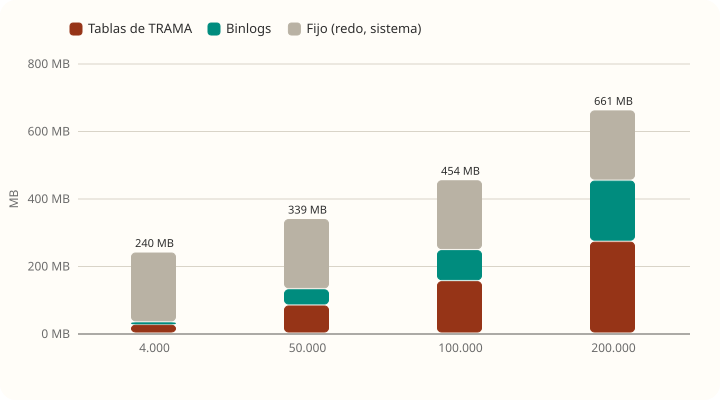
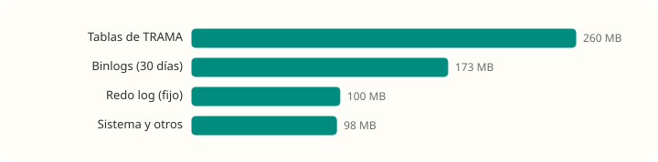
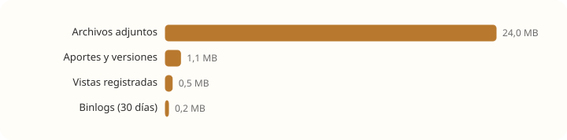
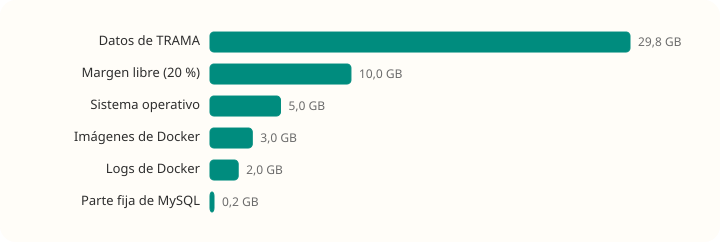
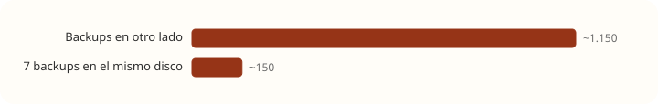

# Capacidad: cuánto entra en 50 GB

[← Volver al resumen](README.md) · Cómo se midió: [Cómo testeamos](metodologia.md)

## Cuánto ocupa cada cosa (medido)

Se cargaron 200.000 aportes, 100 archivos de 1 MB y se hizo un volcado de la base, midiendo el disco en cada paso. MySQL guardó sus datos en un disco virtual con tope de 35 GB, para no llenar la máquina.

| Qué | Espacio | Notas |
|---|---|---|
| Un aporte | **~1,3 KB** en la base | Incluye índices y su fila en `registro_accion`. Medido entre 50.000 y 200.000 aportes |
| Un aporte en los binlogs | ~0,9 KB | MySQL los guarda **30 días** y después los borra solo |
| Un archivo adjunto | **su tamaño + 28 bytes** | Se guarda cifrado con AES-GCM; el cifrado casi no agrega |
| Una vista de perfil | ~0,3 KB | Una fila por persona, por niño y por día |
| Parte fija de MySQL | ~210 MB | Redo log (100 MB), tablas del sistema y undo. No crece con los datos |
| Backup de la base | ~0,4 KB por aporte comprimido | 200.000 aportes: 130 MB sin comprimir, 79 MB con gzip. El texto cifrado comprime poco |
| Imágenes de Docker | ~2,1 GB | MySQL 1,1 GB, backend 613 MB, OpenBao 259 MB, frontend 82 MB |

| Aportes | Tablas de TRAMA | Binlogs | MySQL en total |
|---|---|---|---|
| 4.000 | 26 MB | 7 MB | 240 MB |
| 50.000 | 83 MB | 48 MB | 339 MB |
| 100.000 | 155 MB | 92 MB | 454 MB |
| 200.000 | 272 MB | 181 MB | 661 MB |

## Supuestos de uso

No hay datos reales de uso todavía. Estos supuestos son a propósito generosos; se pueden cambiar y rehacer la cuenta con la tabla de arriba.

| Supuesto (por niño) | Valor |
|---|---|
| Personas en su red | 5 |
| Aportes cargados | 2 por día → 730 por año |
| Aportes editados una vez | 20 % → 146 versiones por año |
| Personas que miran su perfil cada día | las 5 → 1.825 filas de vista por año |
| Archivos adjuntos | 2 por mes de 1 MB → 24 MB por año |

**Un niño ocupa ~26 MB por año:**

| Parte | Por año | Porcentaje |
|---|---|---|
| Archivos adjuntos | 24 MB | **93 %** |
| Aportes y versiones (876 × 1,3 KB) | 1,1 MB | 4 % |
| Vistas (1.825 × 0,3 KB) | 0,5 MB | 2 % |
| Binlogs (30 días) | ~0,2 MB | 1 % |

**Los archivos adjuntos son casi todo el disco.** El texto ocupa muy poco.

## Cuánto queda libre en un disco de 50 GB

| Reserva | Espacio | Por qué |
|---|---|---|
| Sistema operativo y paquetes | 5 GB | Ubuntu Server con actualizaciones |
| Imágenes de Docker | 3 GB | 2,1 GB de imágenes más capas viejas al actualizar |
| Logs de Docker | 2 GB | El compose **no configura rotación de logs**: hoy crecen sin límite |
| Parte fija de MySQL | 0,2 GB | |
| **Margen libre (20 %)** | 10 GB | **Con el disco lleno TRAMA se cae entera** ([casos-limite.md](casos-limite.md#disco-lleno)). No conviene pasar del 80 % |
| **Queda para datos** | **~30 GB** | |

## Resultado

| Escenario | Por niño y año | Capacidad en 30 GB |
|---|---|---|
| **Backups en otro lado** (otro disco, otro servidor o almacenamiento externo) | 26 MB | **~1.150 niño-años** (por ejemplo, 575 niños durante 2 años) |
| **7 backups diarios en el mismo disco** | 26 MB + 7 copias de sus 24 MB de adjuntos ≈ 196 MB | **~150 niño-años** |
| **Sin archivos adjuntos** (solo texto) | 1,7 MB | ~17.500 niño-años |
| **Con el script de backup actual** (diario, sin borrar los viejos) | crece sin límite | Con 100 niños con un año de datos (~2,6 GB), cada backup pesa ~2,4 GB: **el disco se llena en unos 12 días** |

## Backups

`backup/backup.sh` funciona bien (cifra con AES-256 y no deja copias sin cifrar), pero para la capacidad tiene dos problemas:

1. **No borra backups viejos.** Cada corrida agrega un archivo nuevo en `backups/` y ninguno se elimina.
2. **Cada backup es completo:** la base más **todos** los archivos adjuntos. Además, mientras se arma, copia todos los adjuntos a una carpeta temporal, así que necesita **espacio libre igual al total de adjuntos** solo para correr.

**Qué haría:**

- Guardar los backups **fuera del servidor** (es lo que de verdad protege ante la pérdida del servidor).
- Si se dejan en el mismo disco, rotar: por ejemplo, 7 diarios y 4 semanales.
- Copiar los adjuntos de forma incremental (por ejemplo con `rsync` o `restic`) en lugar de incluirlos enteros cada vez. Agregar una herramienta nueva requiere acordarlo con el equipo.

## El límite que llega antes que el disco

Con los mismos supuestos, un niño activo llega a **1.000 aportes en unos 16 meses**. Desde ahí su perfil tarda **3,7 s** en 1 CPU · 2 GB (ver [casos-limite.md](casos-limite.md#niños-con-muchos-aportes)). **El rendimiento se degrada mucho antes de que el disco se llene**, hasta que se paginen las listas.

## Recomendaciones de operación

| Qué | Cómo |
|---|---|
| Alerta de disco | Avisar cuando pase el 80 % |
| Rotación de logs de Docker | `logging: { driver: json-file, options: { max-size: "10m", max-file: "5" } }` en cada servicio |
| Binlogs | Si no hay réplica, apagarlos (`--skip-log-bin`) o bajar `binlog_expire_logs_seconds` a 3 días |
| Backups | Fuera del servidor, con rotación |
| Adjuntos | Si crecen, moverlos a un almacenamiento aparte del disco de la base |
