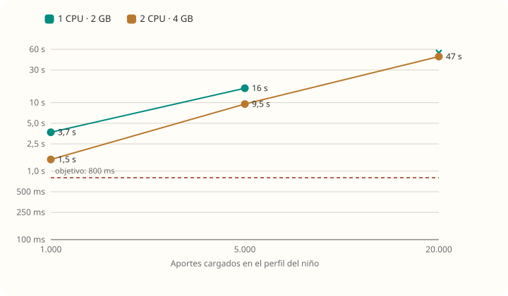
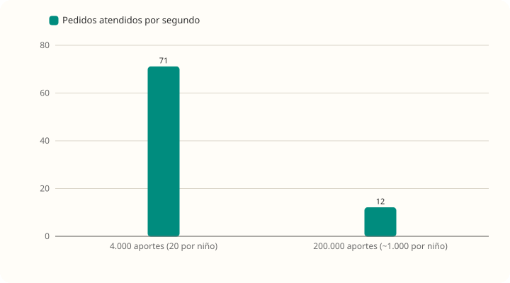
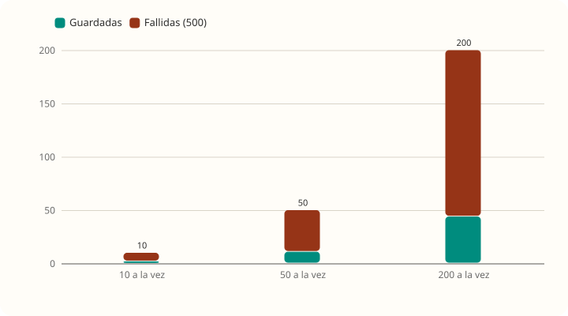
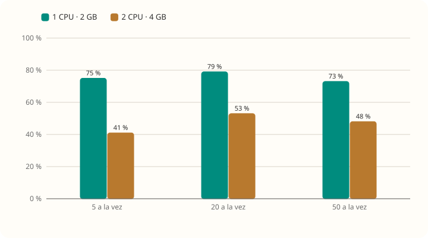
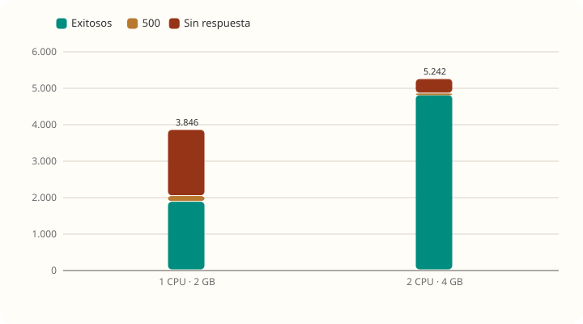
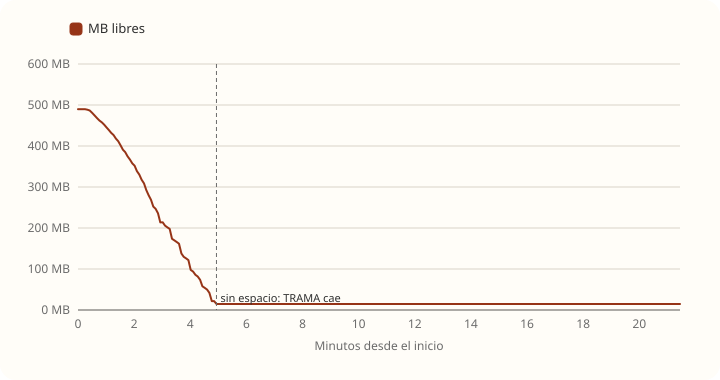

# Casos límite

[← Volver al resumen](README.md) · Cómo se midió: [Cómo testeamos](metodologia.md)

Cada caso se corrió en **1 CPU · 2 GB** y **2 CPU · 4 GB**. Las respuestas se contaron por código HTTP, para saber exactamente qué recibe la persona.

## Niños con muchos aportes

20 personas mirando a la vez el perfil (lista de aportes + bitácora) del mismo niño:

| Aportes del niño | 2 GB · p95 | 2 GB · mediana | 4 GB · p95 | Errores |
|---|---|---|---|---|
| 1.000 | **3,7 s** | 2,0 s | 1,5 s | 0 % |
| 5.000 | **16,2 s** | 9,6 s | 9,5 s | 0 % |
| 20.000 | **60 s (corte)** | 45 s | 47 s | 2 GB: **91 %, el backend dejó de responder** · 4 GB: 0 % |

Y con la base grande completa (200.000 aportes, unos 1.000 por niño), la misma carga mezclada de siempre en 1 CPU · 2 GB:

| 100 usuarios | 4.000 aportes en la base | 200.000 aportes en la base |
|---|---|---|
| p95 general | 279 ms | **15,3 s** |
| p95 de ver el perfil | 50 ms | **14,8 s** |
| Pedidos atendidos por segundo | 71 | **12** |

**Por qué pasa.** `GET /api/proyectos/{id}/aportes` y `GET /bitacora` devuelven **todos** los aportes del niño en cada pedido:

1. Se traen todas las filas de `aporte` del niño.
2. Por **cada** aporte se hace una consulta para buscar sus adjuntos (problema N+1): con 20.000 aportes son 20.000 consultas para abrir un perfil.
3. Por cada aporte se descifran `contenido` y `datos` (AES).
4. Se arma un JSON con todo, que el navegador tiene que bajar y dibujar.

El tamaño total de la base no importa: MySQL respondió rápido aun con 200.000 aportes. **Importa cuántos aportes tiene cada niño.** Un niño con 4 o 5 personas que cargan un par de cosas por día llega a 1.000 aportes en menos de un año.

**Qué haría:** paginar las dos listas (por ejemplo, de a 50, ordenadas por fecha), traer los adjuntos de la página con **una** consulta (`IN (...)` o `JOIN FETCH`) y, si hace falta, un índice por `(proyecto_id, creado_en)`.

## Ediciones simultáneas

Varias personas guardando **el mismo aporte** al mismo tiempo (en la práctica: el autor con la app abierta en dos dispositivos, o un doble clic en "Guardar"):

| Ediciones a la vez | Guardadas (`200`) | Fallidas (`500`) | Versiones en la base |
|---|---|---|---|
| 10 | 2 | 8 | 2 |
| 50 | 11 a 13 | 37 a 39 | 11 a 13 |
| 200 | 41 a 44 | 156 a 159 | 41 a 44 |

- **No se pierden ni se mezclan datos:** cada edición exitosa dejó exactamente una versión en `aporte_version`.
- **Pero la persona recibe `500 Ocurrió un error inesperado`.** El backend registra `Deadlock found when trying to get lock` (MySQL 1213) y `OptimisticLockException`: dos transacciones se bloquean entre sí al actualizar el aporte e insertar la versión.

**Qué haría:** atrapar el conflicto y responder `409` con un mensaje claro ("Este aporte se acaba de guardar desde otro lado. Revisá los cambios y volvé a intentar"), o reintentar una vez.

## Archivos adjuntos

| Subidas de 5 MB a la vez | 2 GB: subidas fallidas | 4 GB: subidas fallidas |
|---|---|---|
| 5 | 75 % | 41 % |
| 20 | 79 % | 53 % |
| 50 | 73 % | 48 % |

Con un backend **recién iniciado**, 5 personas subiendo y bajando archivos de 1 MB y de 5 MB: **0 fallas** en 242 subidas y 242 descargas. Las fallas aparecen **después de un pico de uso**.

**Causa (confirmada con Java Flight Recorder):** 806 `OutOfMemoryError` de **memoria directa** (`java.nio.Bits.reserveMemory`), 622 al subir y 184 al bajar:

1. `ArchivoService.subir` (línea 142) y `ArchivoService.descargar` (línea 211) usan `Files.write` y `Files.readAllBytes`, que trabajan con el archivo **entero** en memoria.
2. Por debajo, Java copia los bytes a un buffer de memoria directa **del tamaño del archivo** y lo **guarda en cada hilo** para reutilizarlo.
3. Tomcat tiene hasta 200 hilos. Después de un pico (en la prueba, la edición simultánea con 200 personas), muchos hilos guardan su buffer de 5 MB. Cuando la suma pasa el límite de memoria directa (igual al heap: ~280 MB en 2 GB y ~600 MB en 4 GB), **toda subida o descarga nueva falla**.
4. `GlobalExceptionHandler` lo devuelve como `500` **sin escribirlo en el log**, así que en producción no habría rastro.

En producción aparecería después del primer pico de uso y **no se iría hasta reiniciar el backend**.

**Qué haría:** leer, cifrar y escribir los archivos por partes (`InputStream` → `CipherOutputStream` → archivo), y servir las descargas como *stream*. Como paliativo inmediato, sin tocar código: agregar `-Djdk.nio.maxCachedBufferSize=262144` a las opciones de Java.

## Tormenta de logins

De 1 a 80 logins por segundo en 3 minutos:

| Servidor | Logins exitosos | `500` (sin conexión libre) | Sin respuesta en 60 s | Promedio atendido |
|---|---|---|---|---|
| 1 CPU · 2 GB | 1.874 | 159 | **1.813** | 7,8 por segundo |
| 2 CPU · 4 GB | 4.798 | 49 | 395 | 20 por segundo |

Cada login cuesta ~100 ms de CPU por BCrypt **y retiene una conexión a la base durante ese tiempo** (ver [rendimiento.md](rendimiento.md#qué-satura-a-trama)). En las dos pruebas el backend quedó sin responder al terminar y hubo que reiniciarlo para seguir.

Esto es lo que pasaría con un **ataque de fuerza bruta** o, sin mala intención, **a la hora de entrada a la escuela** si muchas personas entran juntas. Hoy no hay un límite de intentos por IP (ver [seguridad.md](seguridad.md)).

## Textos largos

50 personas cargando aportes de 10.000 caracteres (el máximo permitido):

| Servidor | Aportes guardados | p95 | Errores |
|---|---|---|---|
| 1 CPU · 2 GB | 2.675 | 172 ms | 0 % |
| 2 CPU · 4 GB | 2.833 | 42 ms | 0 % |

Sin problemas: el límite de 10.000 caracteres está bien elegido.

## Disco lleno

MySQL en un disco de 700 MB que se llena cargando aportes. **Es el caso más grave para la operación:**

1. **Fallan las escrituras.** MySQL no puede agrandar las tablas: `The table 'aporte' is full` (8.915 veces) y `The table 'registro_accion' is full` (17.608 veces; cada carga, edición o confirmación deja una fila de registro).
2. **Falla la primera vista del día.** `registrarVista` guarda una fila por persona, niño y día; con el disco lleno esa escritura falla y el perfil da error aunque solo se quiera mirar.
3. **Se cuelga todo.** MySQL no puede escribir el binlog y queda esperando: `Disk is full writing './binlog.000003' ... Waiting for someone to free space... Retry in 60 secs`. Las 10 conexiones quedan tomadas y **el backend deja de responder por completo**, incluido el login.
4. **No se recupera sola.** Se intentó liberar espacio con `PURGE BINARY LOGS`, pero el binlog que ocupa el lugar es el que está en uso. Hace falta agrandar el disco o reiniciar MySQL a mano.

**Qué haría:** una alerta cuando el disco pase el 80 %, rotación de backups, bajar la retención de binlogs (`binlog_expire_logs_seconds`, hoy 30 días) o apagarlos si no hay réplica, y dejar siempre un margen libre. Ver [capacidad-50gb.md](capacidad-50gb.md).
