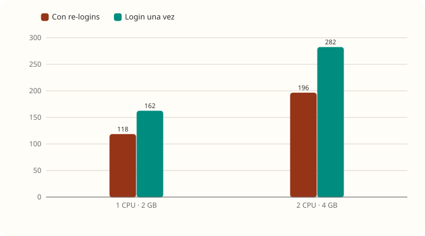
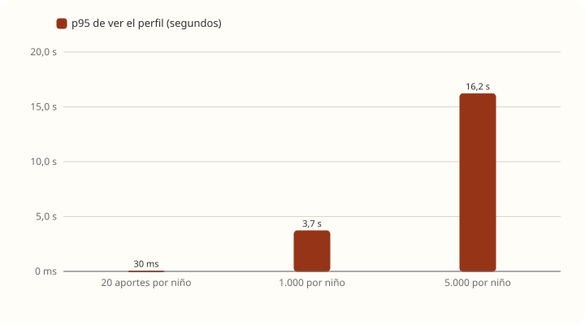
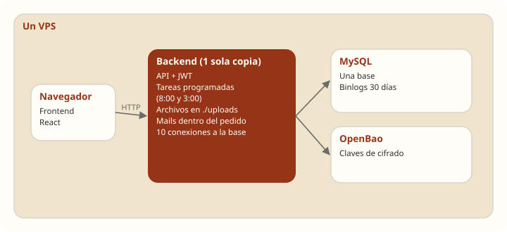
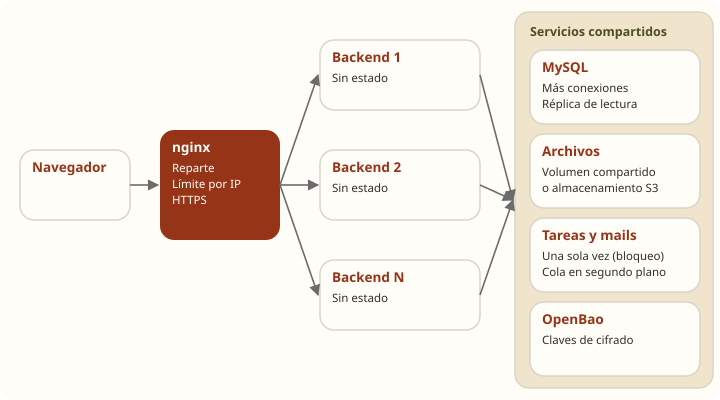

# Escalabilidad

[← Volver al resumen](README.md) · Datos de base: [rendimiento.md](rendimiento.md) y [casos-limite.md](casos-limite.md)

## Respuesta corta

**TRAMA escala bien en cantidad de familias y de datos totales, escala a medias agrandando el servidor, no escala en aportes por niño y hoy no puede tener más de una copia del backend.**

Lo que está medido y lo que es estimación se marca en cada caso. Las estimaciones salen de las mediciones de los capítulos anteriores, no de supuestos sueltos.

| Dimensión | ¿Escala? | Evidencia |
|---|---|---|
| Datos totales en la base | ✅ Sí | Con 200.000 aportes MySQL respondió igual de rápido; ninguna consulta pasó de 0,2 ms. **Medido** |
| Cantidad de familias y niños | ✅ Sí | Cada niño es independiente; sumar niños solo suma datos, que MySQL maneja bien. **Medido** con 200 niños |
| Agrandar el servidor (vertical) | ⚠️ A medias | El doble de CPU dio entre un 66 % y un 74 % más de pedidos por segundo, no el doble. **Medido** |
| **Aportes por niño** | ❌ No | Cada pedido trae todos los aportes del niño: con 1.000, abrir un perfil tarda 3,7 s; con 5.000, 16 s. **Medido** |
| **Más copias del backend (horizontal)** | ❌ Hoy no | Archivos en el disco local y tareas programadas que se repetirían en cada copia. **Leído en el código** |
| Logins a la vez | ❌ No | ~16 a 20 logins por segundo como máximo y, pasado eso, todo el sistema espera. **Medido** |
| Mails | ⚠️ A medias | Se envían dentro del pedido: con Gmail lento, el pedido espera y retiene su conexión. **Leído en el código** |
| Disco | ⚠️ A medias | Crece con los adjuntos y los backups completos sin rotación; lleno, la app cae entera. **Medido** |

## Escalado vertical: agrandar el servidor



| Pasar de 1 CPU · 2 GB a 2 CPU · 4 GB | Antes | Después | Mejora |
|---|---|---|---|
| Techo con re-logins | 118 pedidos/s | 196 pedidos/s | +66 % |
| Techo con login una vez | 162 pedidos/s | 282 pedidos/s | +74 % |
| p95 con 200 usuarios | 1,4 s | 234 ms | 6 veces mejor |

**Por qué no rinde el doble:**

1. **Las 10 conexiones a la base no crecen con el servidor.** Con más CPU se atienden más pedidos a la vez, pero siguen turnándose las mismas 10 conexiones: con 600 usuarios en 4 GB los pedidos sumaron 11.150 s de espera por conexión en un minuto.
2. **MySQL y el backend comparten la CPU.** En 4 GB, MySQL usó hasta el 40 % de un núcleo.

**Hasta dónde conviene agrandar** (estimación): con el código de hoy, pasar a 4 CPU · 8 GB daría otro +50 % a +70 % de techo, siempre que se suban también las conexiones (`spring.datasource.hikari.maximum-pool-size`). Pasado eso, el costo crece más rápido que el beneficio, y **ningún servidor resuelve el problema de los aportes por niño**.

## El problema que no se resuelve con más servidor: aportes por niño



Es la dimensión que **no escala** y la más importante, porque crece sola con el uso: cada niño suma aportes todos los días.

**Por qué no escala.** El costo de abrir un perfil es **proporcional a la cantidad de aportes del niño**, porque:

| Paso | Costo con 20 aportes | Costo con 5.000 aportes |
|---|---|---|
| Traer los aportes de la base | 20 filas | 5.000 filas |
| Buscar los adjuntos de cada uno (N+1) | 20 consultas | **5.000 consultas** |
| Descifrar contenido y datos (AES) | 40 descifrados | 10.000 descifrados |
| Armar el JSON y mandarlo | ~20 KB | ~5 MB |

Un niño activo llega a 1.000 aportes en unos 16 meses con los supuestos de [capacidad-50gb.md](capacidad-50gb.md). **En un servidor de cualquier tamaño, el tiempo sigue creciendo con cada aporte nuevo.**

**Cómo podría escalar.** Haciendo que el costo de cada pedido **no dependa** de cuántos aportes tiene el niño:

1. **Paginar** `GET /aportes` y `GET /bitacora`: la pantalla pide de a 50, ordenados por fecha, y carga más al bajar. Spring Data lo resuelve con `Pageable` y una respuesta `Page`. Requiere el cambio correspondiente en el frontend.
2. **Sacar el N+1 de adjuntos.** La forma más rápida, sin tocar código, es una propiedad de Hibernate que trae los adjuntos de varios aportes juntos:
   ```properties
   spring.jpa.properties.hibernate.default_batch_fetch_size=50
   ```
   Con eso, 5.000 consultas pasan a ser unas 100. La forma prolija es traerlos en la misma consulta (`@EntityGraph` o `JOIN FETCH`) solo para la página pedida.
3. **Índice para la página:** `(proyecto_id, archivado, creado_en)` en `aporte`, para que pedir "los 50 más recientes" no recorra todos. Requiere una migración nueva.

Con las tres cosas, abrir un perfil cuesta lo mismo con 20 que con 20.000 aportes (estimación: el mismo orden que hoy con 20 aportes, unas decenas de milisegundos).

## Escalado horizontal: varias copias del backend



La buena noticia es que **TRAMA ya es casi "sin estado"**: el JWT se valida con una clave compartida, no hay sesiones HTTP ni datos guardados en memoria, y los bloqueos de cuentas y códigos viven en la base. Eso es lo más difícil de lograr y ya está.

**Lo que hoy impide tener dos o más copias:**

| Bloqueo | Por qué | Qué pasaría con 2 copias |
|---|---|---|
| **Archivos en el disco local** | `ArchivoService` guarda en `trama.archivos.directorio` (`./uploads`) del propio contenedor | Una foto subida a la copia 1 no existe para la copia 2: la mitad de las descargas darían "archivo no encontrado" |
| **Tareas programadas** | `AvisoAcuerdoService` (todos los días a las 8:00) y `EliminacionProyectoService` (a las 3:00) usan `@Scheduled` | Cada copia las ejecuta: **mails de acuerdos vencidos duplicados** y dos procesos borrando los mismos proyectos a la vez |
| **Mails dentro del pedido** | No hay `@Async` ni cola | No impide escalar, pero cada copia retiene conexiones mientras espera a Gmail |
| **Sin reparto de pedidos** | El compose publica el backend directo, sin un nginx adelante | No hay quién reparta entre copias |

**Cómo podría escalar horizontalmente:**



1. **nginx adelante** (ya está en el repo para el frontend), repartiendo `/api` entre copias con `upstream`. De paso, resuelve el límite por IP y HTTPS (ver [remediacion.md](remediacion.md)).
2. **Archivos fuera del contenedor.** Opción simple: un volumen compartido montado en todas las copias (en un solo servidor alcanza). Opción a futuro: un almacenamiento de objetos compatible con S3. Los archivos ya se guardan cifrados, así que el proveedor no ve el contenido.
3. **Tareas programadas una sola vez.** Opciones, de menor a mayor esfuerzo: activarlas solo en una copia con una variable (`TRAMA_TAREAS_ACTIVAS=true` y `@ConditionalOnProperty`); o un bloqueo en la base para que solo una copia las ejecute. Existe una librería para esto (ShedLock), pero agregarla requiere acordarlo con el equipo.
4. **Mails en segundo plano**, con `@Async` o una tabla de mails pendientes que procese una tarea. Así el pedido responde sin esperar a Gmail.
5. **Conexiones a MySQL:** cada copia abre 10. MySQL acepta 151 por defecto, así que entran unas 12 copias antes de tocar su configuración.

## Logins: el cuello de botella de BCrypt

BCrypt es lento **a propósito**. No hay que hacerlo más rápido: hay que evitar que trabe al resto.

| Problema | Por qué | Cómo podría escalar |
|---|---|---|
| El login retiene una conexión mientras calcula BCrypt | Open Session In View activado | `spring.jpa.open-in-view=false`: la conexión se suelta apenas se lee el usuario |
| Un pico de logins frena a todos | Comparten la misma CPU y las mismas 10 conexiones | Límite por IP en nginx; separar logins a su propio grupo de hilos si hiciera falta |
| Cada login consume ~100 ms de CPU | Es el costo de BCrypt con fuerza 10 | Mantenerlo: es la protección. Con varias copias, el costo se reparte |

Sacando los re-logins, el techo **medido** subió un 37 % en 2 GB y un 44 % en 4 GB. Con `open-in-view=false` se espera que la saturación sea **gradual** en vez de brusca, porque el resto de los pedidos ya no esperaría una conexión retenida por BCrypt (estimación; conviene medirlo después del cambio).

## Qué ganaría cada cambio

Cambios ordenados por cuánto mejoran la escalabilidad respecto del esfuerzo. Las mejoras **medidas** vienen de las pruebas; las **estimadas** se calcularon con las grabaciones de Java Flight Recorder y deberían confirmarse midiendo después del cambio.

| Cambio | Esfuerzo | Qué mejora | Tipo |
|---|---|---|---|
| Paginación + adjuntos en una consulta | Medio (backend + frontend) | El perfil deja de empeorar con cada aporte | Estimado, sobre medición |
| `default_batch_fetch_size=50` | Una línea | Las listas pasan de N+1 a ~N/50 consultas | Estimado |
| `open-in-view=false` | Una línea + revisar tests | La saturación deja de ser brusca | Estimado |
| Menos re-logins (el token dura 8 h) | Ninguno en el backend | +37 % a +44 % de techo | **Medido** |
| Pasar de 1 CPU · 2 GB a 2 CPU · 4 GB | Costo mensual | +66 % a +74 % de techo | **Medido** |
| Permisos una vez por pedido (hoy ~4,5) | Bajo | ~15 % menos consultas por pedido | Estimado |
| Filtro JWT: un solo parseo del token | Bajo | ~8 % menos de CPU en pedidos livianos (jjwt usa hoy el 12 %) | Estimado |
| Archivos fuera del disco + tareas una vez + nginx | Medio | Habilita varias copias del backend | Requisito |

## Conclusión

Para el tamaño de un lanzamiento (decenas o pocos cientos de familias activas), **un servidor de 1 CPU · 2 GB alcanza con holgura**, y el de 2 CPU · 4 GB da margen para crecer. El riesgo real no es la cantidad de gente sino **el tiempo**: a medida que cada niño acumula aportes, la app se vuelve lenta para esa familia, sin importar el servidor.

Por eso, antes de pensar en más servidores, lo que más escalabilidad da es **paginar las listas**. Después, cuando haga falta crecer de verdad, los cambios para tener varias copias del backend son pocos y concretos, porque la base sin estado ya está.
