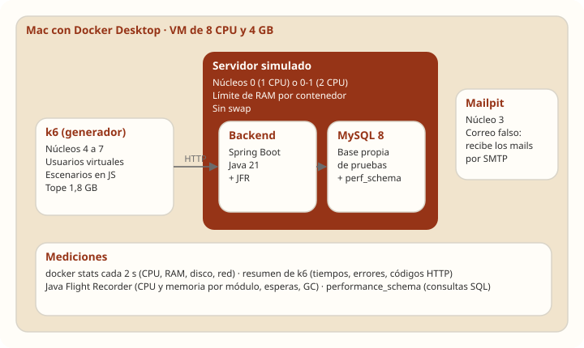
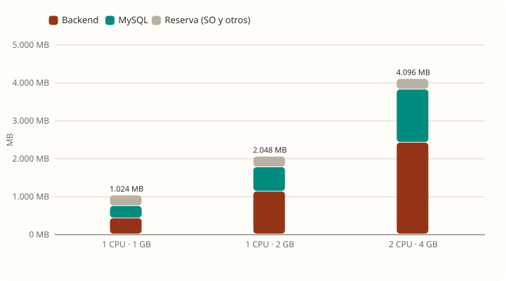
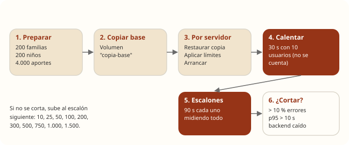
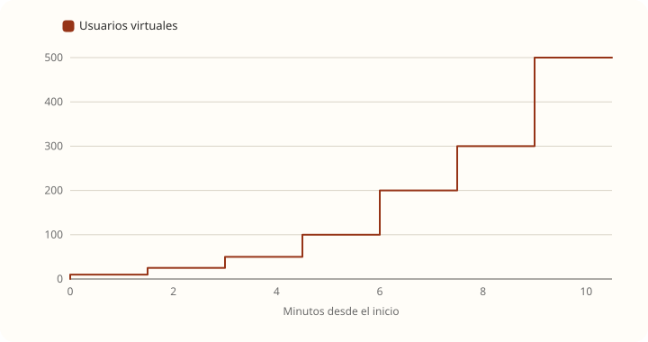
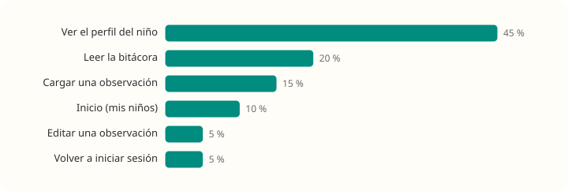
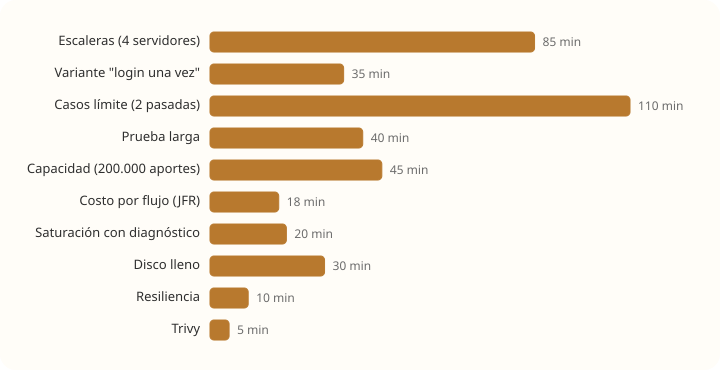

# Cómo testeamos

[← Volver al resumen](README.md)

## Objetivo

Responder cinco preguntas con mediciones, no con estimaciones:

1. ¿Qué servidor conviene pagar y cuánto aguanta cada uno?
2. ¿Qué es **exactamente** lo que satura a TRAMA?
3. ¿Qué pasa en los casos límite: niños con muchos aportes, picos de logins, archivos, disco lleno?
4. ¿Cuánto entra en un disco de 50 GB?
5. ¿Qué vulnerabilidades tiene hoy?

## El entorno

Todo corrió en una Mac (Apple Silicon, 8 núcleos, 8 GB) con Docker Desktop, en una carpeta **fuera del repo** (`~/Documents/Trama-pruebas`), con su propio compose, su propia base y sus propias claves. El repo, la base de desarrollo y el `docker-compose.yml` no se tocaron.

| Pieza | Detalle |
|---|---|
| Backend | La imagen del repo (`trama-backend:local`, compilada desde `develop`): Spring Boot 3.1.11, Java 21. Perfil `dev` con las claves por variable de entorno; `prod` solo cambia de dónde salen las claves (OpenBao) |
| Base | MySQL 8.0 con los mismos parámetros del compose del repo |
| Generador de carga | [k6](https://k6.io) 0.54.0 en Docker. Cada escenario es un script en JavaScript |
| Mails | Mailpit, un servidor de correo falso. Ningún mail salió a internet |
| Aislamiento | El "servidor" usa los núcleos 0 y 1; k6 usa del 4 al 7 y Mailpit el 3. Así el generador no le roba CPU al servidor que se mide |

## Cómo se simuló cada servidor

Un VPS barato tiene todo en la misma máquina: MySQL, el backend, OpenBao, nginx y el sistema operativo compartiendo CPU y memoria. Para reproducirlo:

- **CPU:** MySQL y el backend se fijaron a los **mismos** núcleos (`cpuset`): uno para los servidores de 1 CPU y dos para el de 2 CPU. Compiten entre sí como en un VPS real.
- **Memoria:** cada contenedor tiene un tope y **no tiene swap**. Si lo pasa, el sistema lo mata, como pasaría en el servidor.
- **Reserva:** se dejaron unos 280 MB para el sistema operativo, Docker, OpenBao y nginx.

| Servidor | Núcleos | RAM de MySQL | RAM del backend | Ajustes |
|---|---|---|---|---|
| 1 CPU · 1 GB | 1 | 320 MB | 424 MB | Ninguno (como el compose del repo) |
| 1 CPU · 1 GB ajustado | 1 | 320 MB | 424 MB | MySQL sin `performance_schema` y buffer de 64 MB; Java con heap al 70 % |
| 1 CPU · 2 GB | 1 | 640 MB | 1.128 MB | Ninguno |
| 2 CPU · 4 GB | 2 | 1.400 MB | 2.416 MB | Ninguno |

## Datos de prueba

- **200 familias inventadas** (`familia1@prueba.trama.test` a `familia200@…`), cada una con un niño y 20 aportes: 4.000 aportes entre observaciones y estrategias. Todos los textos son ficticios.
- Las cuentas se crearon por la API (`POST /api/auth/registro`), igual que una persona. Solo se marcó el email como verificado directamente en la base, para no tener que leer 200 códigos.
- Terminada la carga, se guardó una **copia de la base**. Antes de cada servidor se restaura esa copia, así todos arrancan exactamente iguales.

## El proceso de cada prueba

1. **Restaurar** la copia de la base y levantar los contenedores con los límites del servidor.
2. **Calentar** 30 segundos con 10 usuarios. Java compila el código más usado en los primeros minutos; sin calentamiento, el primer escalón saldría peor de lo que es.
3. **Subir de a escalones** de 90 segundos. En cada uno se guarda el resumen de k6 y se mide CPU, memoria, disco y red cada 2 segundos.
4. **Cortar** cuando hay más del 10 % de errores, el p95 pasa los 10 segundos o el backend deja de responder. Subir más no agrega información.

## El escenario de uso mezclado

Cada usuario virtual es una familia que inicia sesión, toma el niño de su cuenta y repite estas acciones al azar, con pausas de 1 a 3 segundos:

| Acción | Peso | Pedidos |
|---|---|---|
| Ver el perfil del niño | 45 % | `GET /api/proyectos/{id}` + `GET /aportes` |
| Leer la bitácora | 20 % | `GET /bitacora` |
| Cargar una observación | 15 % | `POST /aportes` |
| Inicio | 10 % | `GET /api/proyectos` + `GET /notificaciones/no-leidas/count` |
| Editar una observación propia | 5 % | `PUT /aportes/{id}` |
| Volver a iniciar sesión | 5 % | `POST /api/auth/login` |

Para separar el peso de BCrypt se repitió la escalera con la **variante "login una vez"**: cada usuario inicia sesión al empezar y su 5 % de re-login pasa a ver aportes.

## Las pruebas, una por una

| Prueba | Cómo se hizo | Qué se buscaba |
|---|---|---|
| **Escalera hasta saturar** | Uso mezclado de 10 a 1.500 usuarios, 4 servidores | Techo de cada servidor |
| **Variante "login una vez"** | La misma escalera sin re-logins, en 2 GB y 4 GB | Cuánto pesa BCrypt |
| **Costo por flujo** | Cada flujo solo, a ritmo fijo (20 pedidos/s; 8 para login y 5 para archivos), 60 s grabados con Java Flight Recorder | CPU y memoria de cada módulo |
| **Saturación con diagnóstico** | Uso mezclado en el codo (200 y 300 usuarios) y pasado el techo (400 y 600), con JFR y `performance_schema` | Qué satura exactamente |
| **Prueba larga** | 20 minutos con 100 usuarios | Fugas de memoria |
| **Resiliencia** | Con 50 usuarios activos, MySQL se apaga 30 s y se vuelve a prender | Si TRAMA se recupera sola |
| **Tormenta de logins** | De 1 a 80 logins por segundo en 3 minutos | Fuerza bruta o entrada masiva |
| **Ediciones simultáneas** | 10, 50 y 200 personas guardando **el mismo** aporte a la vez; después se cuentan las versiones en la base | Integridad de datos |
| **Textos largos** | 50 personas cargando aportes de 10.000 caracteres | El máximo permitido |
| **Archivos** | 5, 20 y 50 personas subiendo y bajando archivos de 5 MB | Memoria y disco |
| **Niño con muchos aportes** | Se cargaron 1.000, 5.000 y 20.000 aportes en un niño; 20 personas miran su perfil | Listas sin paginar |
| **Capacidad** | 200.000 aportes, 100 archivos y un volcado de la base, midiendo el disco en cada paso | Cuánto ocupa cada cosa |
| **Disco lleno** | MySQL en un disco de 700 MB que se llena cargando aportes; después se intenta liberar espacio | Qué pasa y si se recupera |
| **Enumeración de cuentas** | 20 logins y 20 recuperaciones con emails registrados y 20 con inexistentes, una por cuenta | Si el tiempo revela quién tiene cuenta |
| **Dependencias** | Trivy sobre las imágenes del backend y el frontend; `npm audit` | Vulnerabilidades conocidas |

## Cómo se midió

| Herramienta | Qué mide | Cada cuánto |
|---|---|---|
| **k6** | Tiempo de cada pedido (mediana, p95, p99, máximo), pedidos por segundo, errores y **cantidad de respuestas por código HTTP** | Todos los pedidos |
| **docker stats** | CPU, memoria, disco leído y escrito, y red de cada contenedor | Cada 2 s |
| **docker inspect** | Si el contenedor se reinició o lo mató el sistema por falta de memoria (`OOMKilled`) | Al final de cada escalón |
| **Java Flight Recorder** | Qué código usa la CPU, cuánta memoria pide cada método, esperas de conexiones, bloqueos, pausas del recolector de basura y excepciones | Grabaciones de 60 s |
| **performance_schema** | Cada consulta SQL: cuántas veces se ejecutó, tiempo total, filas examinadas, uso de índices | Por prueba |
| **SHOW GLOBAL STATUS** | Caché de MySQL, conexiones, bloqueos, tablas temporales | Por prueba |
| **du / df** | Tamaño de tablas, binlogs y archivos; espacio libre | Por paso |

Las grabaciones de JFR se procesaron con un script propio que agrupa cada muestra por **capa** (BCrypt, Hibernate, driver de MySQL, Jackson, Tomcat, Spring, JWT, cifrado) y por **módulo de TRAMA** (filtro JWT, aportes, permisos, login, archivos, etc.), mirando qué código estaba en la pila en ese momento.

## Cómo cuidamos que los números sean confiables

**Errores de nuestros propios scripts, encontrados y corregidos:**

| Problema detectado | Cómo se notó | Qué se hizo |
|---|---|---|
| El script editaba *estrategias* con datos de *observación* y TRAMA lo rechazaba (bien) | 0,2 % a 0,7 % de errores incluso con 10 usuarios | Editar solo observaciones y repetir todas las escaleras |
| La carga de 20.000 aportes no se había hecho (error de configuración de k6) | La lista con 20.000 aportes respondía igual que con 1.000 | Cargarlos en paralelo, contar en la base y repetir |
| Los errores de una prueba se mezclaban con los de la anterior en el log | Deadlocks que aparecían en la prueba de archivos | Leer el log desde el inicio exacto de cada prueba |
| El conteo de versiones daba 0 por la tilde de "Edición" | Resultado imposible | Cliente de MySQL en UTF-8 |
| La prueba de resiliencia se cortaba cuando `curl` agotaba su espera | Faltaba el dato de recuperación | Tolerar el corte y repetir |

**Otras precauciones:**

- **Misma base para todos:** cada servidor arrancó desde la misma copia.
- **Calentamiento descartado:** los primeros 30 s no se cuentan.
- **Generador separado:** k6 en otros núcleos y con su propio tope de memoria (1,8 GB), para que si algo se queda sin memoria sea el generador y no el "servidor".
- **Causas confirmadas, no supuestas:** los 500 de los archivos se reprodujeron dos veces y la causa se confirmó con JFR; la enumeración de cuentas se midió, no se dedujo del código.
- **Tope de disco:** la prueba de capacidad usó un disco virtual con un máximo de 35 GB y un control que frenaba la carga si Docker más los discos de prueba pasaban de 45 GB. El uso real máximo fue de 11 GB.

## Cómo leer los números

- **p95**: el 95 % de los pedidos tardó menos que eso. Muestra la experiencia de las personas con peor suerte.
- **Techo**: el máximo de pedidos por segundo que atendió el servidor. Pasado ese punto, más gente se traduce en más espera.
- **Usuario virtual no es una persona.** Un usuario virtual hace una acción cada 1 a 3 segundos; una persona real tarda bastante más entre clics. Conviene pensar en **pedidos por segundo**:

> **Personas activas a la vez ≈ pedidos/s × segundos entre acciones × factor de CPU del VPS**
>
> Con 10 s entre acciones y un factor de 0,5, el techo de 1 CPU · 2 GB (160 pedidos/s) equivale a unas **800 personas usando la app en el mismo momento**, y el de 2 CPU · 4 GB (280 pedidos/s) a unas **1.400**. "Usando en el mismo momento" no es lo mismo que "registradas": suele ser una fracción chica.

## Limitaciones

| Limitación | Efecto |
|---|---|
| Los núcleos de Apple Silicon son más rápidos que un vCPU compartido de VPS | Los techos reales pueden ser **hasta la mitad**. Por eso el factor 0,5 |
| Todo corre en la misma máquina: sin latencia de red ni HTTPS | En producción cada pedido suma la ida y vuelta por internet y el cifrado |
| Mailpit responde al instante | Con Gmail, registro, invitaciones y avisos **frenan el pedido** que los dispara (el envío no es asíncrono). En las pruebas cada niño tiene un solo miembro, así que no hubo avisos al cargar aportes |
| Cada prueba se corrió una vez | Puede haber variaciones de ±10 % entre corridas |
| Datos homogéneos | En la realidad habrá niños con muchos más aportes que otros |
| No se probó el frontend en el navegador | nginx sirve archivos estáticos y no fue un factor |
| No se probaron invitaciones, acuerdos, eventos ni notificaciones por mail | Quedan para una segunda ronda |

## Cómo repetirlo

Los scripts quedaron en `~/Documents/Trama-pruebas`:

| Script | Qué hace |
|---|---|
| `correr.sh preparar` | Crea las 200 familias y guarda la copia de la base |
| `correr.sh <servidor>` | Escalera hasta saturar (`RELOGIN=0` para la variante) |
| `modulos.sh` | Costo por flujo con JFR |
| `saturacion.sh <servidor>` | Diagnóstico, prueba larga, resiliencia y arranque |
| `limites.sh <servidor>` | Casos límite |
| `capacidad.sh` | Capacidad y disco lleno (nunca más de 35 GB) |
| `subidas.sh` | Reproduce la falla de archivos con JFR |
| `datos.js`, `graficos*.js`, `jfr-analisis.js` | Resúmenes, gráficos y análisis de JFR |
