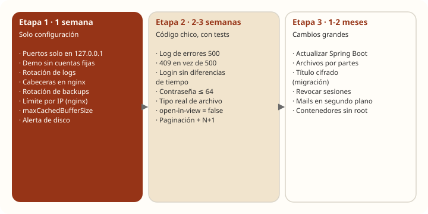
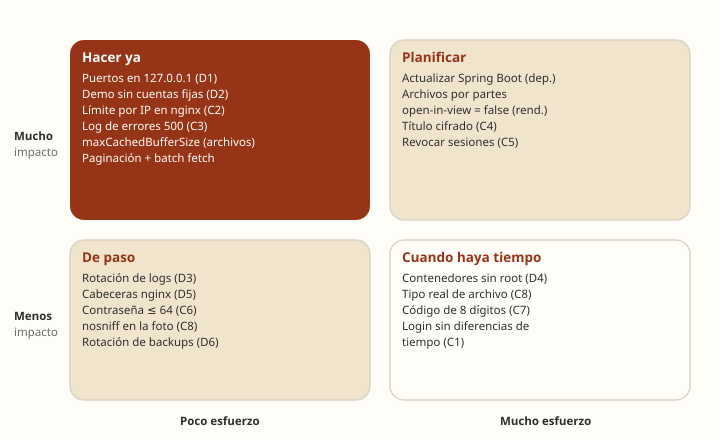

# Cómo arreglar las vulnerabilidades

[← Volver al resumen](README.md) · Hallazgos: [seguridad.md](seguridad.md)

> **Esto es una propuesta.** Ningún cambio de este capítulo está aplicado. Los fragmentos de código muestran el arreglo sobre los archivos reales de TRAMA, pero cada uno tiene que pasar por su tarjeta, sus tests (caso bueno, caso de error y `403` donde corresponda) y su PR, como pide `AGENTS.md`.

## Plan en tres etapas





| Etapa | Qué incluye | Toca código Java | Riesgo de romper algo |
|---|---|---|---|
| **1 · Configuración** (1 semana) | D1, D2, D3, D5, D6, C2, archivos (paliativo) | No | Bajo |
| **2 · Código chico** (2-3 semanas) | C1, C3, C6, C8, *deadlocks*, `open-in-view` | Sí, acotado | Medio: cubrir con tests |
| **3 · Cambios grandes** (1-2 meses) | Dependencias, archivos por partes, C4, C5, C9, D4 | Sí | Alto: rama propia y repetir estas pruebas |

## Etapa 1: configuración

### D1 · Puertos abiertos a internet

**Arreglo** en `docker-compose.yml`, igual que ya están Mailpit, OpenBao y la demo:

```yaml
  mysql:
    ports:
      - "127.0.0.1:3307:3306"
  backend:
    ports:
      - "127.0.0.1:4002:8080"
```

**Verificar:** desde otra máquina de la red, `nc -vz <ip-del-servidor> 3307` tiene que fallar.

### D2 · Demo pública con cuentas de contraseña fija

**Arreglo:** que `DataSeeder` no corra en la demo. Lo más simple, sin tocar el perfil `dev` que usa el equipo, es pedir una variable explícita:

```java
@Component
@Profile("dev")
@ConditionalOnProperty(name = "trama.datos-de-ejemplo", havingValue = "true", matchIfMissing = true)
public class DataSeeder implements CommandLineRunner {
```

Y en `backend-demo` del compose: `TRAMA_DATOS_DE_EJEMPLO: "false"`.

**Verificar:** con la demo levantada, el login con `tutor@trama.test` / `Trama1234!` tiene que dar `401`. Si la base de la demo ya tiene esas cuentas, hay que borrarlas o cambiarles la contraseña.

### D3 · Logs sin rotación

**Arreglo** en `docker-compose.yml`, una vez arriba y referenciado en cada servicio:

```yaml
x-logs: &logs
  driver: json-file
  options: { max-size: "10m", max-file: "5" }

services:
  backend:
    logging: *logs
```

### D5 · Cabeceras de seguridad en nginx

**Arreglo** en `frontend/nginx.conf.template`, dentro de `server`:

```nginx
server_tokens off;
add_header X-Content-Type-Options "nosniff" always;
add_header X-Frame-Options "DENY" always;
add_header Referrer-Policy "strict-origin-when-cross-origin" always;
add_header Content-Security-Policy "default-src 'self'; img-src 'self' data: blob:; style-src 'self' 'unsafe-inline' https://fonts.googleapis.com; font-src 'self' https://fonts.gstatic.com" always;
```

La política de contenido (CSP) hay que probarla con el frontend real: si algo deja de cargar, la consola del navegador dice qué falta permitir.

### D6 · Backups sin rotación

**Arreglo** al final de `backup/backup.sh`:

```sh
# Guardar los últimos 7 backups y borrar los más viejos
ls -1t /backups/trama-*.tar.gz.gpg 2>/dev/null | tail -n +8 | xargs -r rm -f
```

Lo ideal es además **copiar cada backup fuera del servidor**: un backup en el mismo disco no protege si se pierde el servidor.

### C2 · Sin límite de pedidos por IP

**Arreglo** en nginx, sin dependencias nuevas. Va al principio de `nginx.conf.template` (fuera del bloque `server`, porque se incluye dentro de `http`):

```nginx
limit_req_zone $binary_remote_addr zone=auth:10m rate=10r/m;
```

Y en el `server`, una ubicación propia para la autenticación:

```nginx
location /api/auth/ {
    limit_req zone=auth burst=5 nodelay;
    limit_req_status 429;
    set $backend_trama ${DEMO_BACKEND_URL};
    proxy_pass $backend_trama;
    # mismas cabeceras proxy_set_header que en /api/
}
```

Hoy en producción el backend se publica directo. Para que esto proteja, **el tráfico tiene que pasar por nginx** (ver [escalabilidad.md](escalabilidad.md#escalado-horizontal-varias-copias-del-backend)).

**Verificar:** repetir la tormenta de logins (`./limites.sh 1cpu-2gb logins`). Desde una sola IP, después de unos pocos intentos por minuto tienen que llegar `429` y el backend tiene que seguir respondiendo.

### Archivos que fallan después de un pico (paliativo)

Mientras no se cambie `ArchivoService` (etapa 3), una opción de Java evita que cada hilo guarde un buffer del tamaño del archivo:

```yaml
  backend:
    environment:
      JAVA_TOOL_OPTIONS: "-Djdk.nio.maxCachedBufferSize=262144"
```

**Verificar:** repetir `./limites.sh 2cpu-4gb edicion textos archivos`. Las subidas tienen que dar `201` aun después de la edición simultánea.

## Etapa 2: código chico

### C3 · Errores 500 sin registrar

**Arreglo** en `GlobalExceptionHandler.handleUnexpected`. Se registra el tipo y la pila, **nunca** el cuerpo del pedido (puede tener datos del niño):

```java
private static final Logger log = LoggerFactory.getLogger(GlobalExceptionHandler.class);

@ExceptionHandler(Exception.class)
public ResponseEntity<ErrorResponse> handleUnexpected(Exception e, HttpServletRequest request) {
    log.error("Error inesperado en {} {}", request.getMethod(), request.getRequestURI(), e);
    // ... la misma respuesta 500 de hoy
}
```

**Test:** un controlador de prueba que lance una excepción y verificar que la respuesta sigue siendo `500 ERROR_INTERNO`.

### Ediciones simultáneas: `500` por *deadlock*

**Arreglo** en `GlobalExceptionHandler`, una respuesta clara en vez de `500`:

```java
@ExceptionHandler({ CannotAcquireLockException.class, ObjectOptimisticLockingFailureException.class })
public ResponseEntity<ErrorResponse> handleConflicto(Exception e) {
    return ResponseEntity.status(HttpStatus.CONFLICT).body(new ErrorResponse(
            "EDICION_EN_CONFLICTO",
            "Este aporte se acaba de guardar desde otro lado. Revisá los cambios y volvé a intentar."));
}
```

**Verificar:** repetir `./limites.sh 2cpu-4gb edicion`: los fallidos tienen que ser `409`, y las versiones en la base tienen que seguir coincidiendo con las ediciones guardadas.

### C1 · Se puede saber si un email está registrado

**Arreglo** en `AuthenticationService.authenticate`: cuando el email no existe, hacer igual un BCrypt contra un hash fijo, para que tarde lo mismo:

```java
// Hash de una contraseña al azar, calculado una vez en el constructor
// (no en la declaración del campo: ahí passwordEncoder todavía es null)
private final String hashFicticio;
// en el constructor: this.hashFicticio = passwordEncoder.encode(UUID.randomUUID().toString());

Usuario usuario = repository.findByEmail(email).orElse(null);
if (usuario == null) {
    passwordEncoder.matches(request.getPassword(), hashFicticio);   // mismo costo que un email real
    throw new BadCredentialsException("Credenciales inválidas");
}
```

El mensaje `CUENTA_BLOQUEADA` también delata la cuenta. Con el límite por IP (C2) ese dato se vuelve difícil de explotar; si se quiere cerrar del todo, conviene responder lo mismo que ante credenciales inválidas y avisarle a la persona por mail que su cuenta se bloqueó.

**Verificar:** repetir la medición de 20 emails registrados y 20 inexistentes: las medianas tienen que quedar parecidas.

### C6 · Contraseñas de más de 72 bytes

**Arreglo** en `RegisterRequest` y `RestablecerContrasenaRequest`. Se pone 64 caracteres y no 72, porque un carácter con tilde ocupa más de un byte:

```java
@Size(min = 8, max = 64, message = "La contraseña debe tener entre 8 y 64 caracteres")
private String password;
```

Requiere el mismo límite en el formulario del frontend.

### C8 · Tipo real del archivo y `nosniff`

**Arreglo** en `ArchivoService`: además de la extensión, revisar los primeros bytes:

```java
private static boolean coincideFirma(byte[] b, String mime) {
    return switch (mime) {
        case "image/png" -> b.length > 4 && (b[0] & 0xFF) == 0x89 && b[1] == 'P' && b[2] == 'N' && b[3] == 'G';
        case "image/jpeg" -> b.length > 3 && (b[0] & 0xFF) == 0xFF && (b[1] & 0xFF) == 0xD8 && (b[2] & 0xFF) == 0xFF;
        case "application/pdf" -> b.length > 4 && b[0] == '%' && b[1] == 'P' && b[2] == 'D' && b[3] == 'F';
        default -> false;
    };
}
```

Y en `CuentaController.foto`, la misma cabecera que ya tiene el comprobante: `.header("X-Content-Type-Options", "nosniff")`.

### Open Session In View

No es una vulnerabilidad sino la causa de la saturación brusca (ver [rendimiento.md](rendimiento.md#qué-satura-a-trama)), pero conviene hacerlo en esta etapa:

```properties
spring.jpa.open-in-view=false
```

**Riesgo:** si algún controlador recorre una relación perezosa después de salir del servicio, aparece `LazyInitializationException`. Como `AGENTS.md` pide devolver DTOs armados en el servicio, debería haber pocos casos. **Correr todos los tests** y probar cada pantalla.

## Etapa 3: cambios grandes

### Dependencias: actualizar Spring Boot

Resuelve la mayoría de las 13 críticas y 39 altas del backend de una vez (Tomcat, Spring Framework, Spring Security, Jackson).

1. **Rama propia.** Pasar primero a la última versión de la línea 3.x y después evaluar la 4.x, que tiene más cambios.
2. **Spring Cloud tiene que acompañar.** La versión de `spring-cloud-dependencies` (hoy 2022.0.5, que es la de Boot 3.0 y 3.1) tiene que ser la que corresponde a la nueva versión de Spring Boot, según la tabla de compatibilidad de Spring Cloud.
3. **Revisar avisos de compilación y tests:** `./mvnw -B clean test`.
4. **Repetir Trivy** sobre la imagen nueva y **repetir estas pruebas de carga**: cambian Hibernate y Tomcat, y con ellos el rendimiento.

La versión exacta conviene elegirla al momento de hacerlo, con la que tenga soporte vigente en [spring.io](https://spring.io/projects/spring-boot#support).

**Frontend:** reconstruir la imagen con una versión actual de `nginx:<versión>-alpine` y correr `npm audit fix`, que resuelve `follow-redirects`.

### Archivos por partes

El arreglo de fondo del problema de memoria: que `ArchivoService` nunca tenga el archivo entero en un solo arreglo de bytes.

```java
// Subir: del pedido al disco, cifrando de a pedazos
try (InputStream entrada = archivo.getInputStream();
     OutputStream salida = cryptoService.cifrarHacia(Files.newOutputStream(destino))) {
    entrada.transferTo(salida);
}
```

`cifrarHacia` escribiría primero el IV de 12 bytes y devolvería un `CipherOutputStream` con AES-GCM, **manteniendo el mismo formato que hoy** (`[IV][texto cifrado + tag]`), así los archivos que ya existen se siguen leyendo.

Para descargar hay un detalle: Java, al descifrar AES-GCM, retiene todo el contenido hasta verificar la etiqueta final. Igual se gana mucho, porque desaparece el buffer de memoria directa que causaba los `500`; para archivos de hasta 5 MB alcanza. Si en el futuro se permiten archivos grandes, conviene cifrar por bloques independientes.

**Verificar:** repetir `./limites.sh` con archivos y mirar con JFR que no aparezcan `OutOfMemoryError`.

### C4 · Título del aporte cifrado

1. Una migración nueva cambia `aporte.titulo` y `aporte_version.titulo` a un tipo binario (como `contenido`).
2. `@Convert(converter = CifradoConverter.class)` en los dos campos.
3. **Migrar los títulos que ya existen**: Flyway con SQL no puede cifrar con la clave de OpenBao, así que hace falta una migración en Java o una tarea única que lea, cifre y guarde.

No hay ninguna consulta que filtre o busque por título, así que no se rompe ninguna búsqueda. **Para decidir con el equipo:** es un cambio de esquema con migración de datos.

### C5 · Cerrar sesiones al cambiar la contraseña

1. Migración: columna `credenciales_cambiadas_en` en `usuario`, que se actualiza al restablecer la contraseña.
2. En `JwtAuthenticationFilter`, rechazar el token si su fecha de emisión (`iat`) es anterior a esa columna. El usuario ya se busca en cada pedido, así que no agrega consultas.

De paso, el filtro puede parsear el token **una sola vez** (hoy lo hace tres) y leer `subject` y `expiration` del mismo resultado.

### C9 · Mails en segundo plano

`@EnableAsync` y `@Async` en los métodos de `EmailService`, con un grupo de hilos chico propio. Hay que cuidar que el mail se mande **después del commit** (ya existe ese patrón en `AvisoPorEmailService`), y registrar los envíos fallidos sin el contenido del mail.

### D4 · Contenedores sin root

En `backend/Dockerfile`, en la etapa final:

```dockerfile
RUN useradd --system --uid 10001 trama && chown -R trama /app
USER trama
```

Para el frontend, la variante `nginx-unprivileged` escucha en el 8080 sin root; hay que ajustar el puerto en el compose.

### C7 · Código de recuperación

Con el límite por IP (C2) el riesgo baja mucho. Si además se quiere reforzar: códigos de 8 dígitos y un máximo de intentos **por cuenta y por día**, no solo por código.

## Cómo saber que quedó arreglado

| Hallazgo | Prueba que lo encontró | Resultado esperado después |
|---|---|---|
| D1 | `nc` desde otra máquina | Puerto cerrado |
| D2 | Login con la cuenta fija | `401` |
| C2 | `limites.sh … logins` | `429` desde una IP y el backend sigue respondiendo |
| Archivos | `limites.sh … edicion textos archivos` | Subidas `201` después del pico |
| *Deadlocks* | `limites.sh … edicion` | `409` en lugar de `500`, versiones intactas |
| C1 | 20 + 20 logins midiendo el tiempo | Medianas parecidas |
| C3 | Error forzado en un test | Aparece en el log, sin datos del niño |
| Dependencias | Trivy | Sin críticas aplicables |
| Rendimiento | `correr.sh` en 1 CPU · 2 GB | Techo igual o mejor que 162 pedidos/s |
