# Rendimiento: techo de cada servidor y qué lo satura

[← Volver al resumen](README.md) · Cómo se midió: [Cómo testeamos](metodologia.md)

## Escalera hasta saturar

CPU expresada en porcentaje de **un** núcleo (backend + MySQL). En los servidores de 1 CPU el total disponible es 100 %; en el de 2 CPU, 200 %.

### 1 CPU · 1 GB

**Con el compose actual no arranca:** MySQL 8 con su configuración de fábrica necesita más de los 320 MB que le quedan y el sistema lo mata al iniciar (código de salida `137`, `OOMKilled`).

**Ajustado** (sin `performance_schema`, buffer de 64 MB, Java con heap al 70 %):

| Usuarios | p95 | Mediana | Errores | Pedidos/s | CPU | RAM backend | RAM MySQL |
|---|---|---|---|---|---|---|---|
| 10 | 91 ms | 21 ms | 0 % | 7 | 19 % + 4 % | 418 MB | 139 MB |
| 25 | 148 ms | 13 ms | 0 % | 18 | 32 % + 9 % | 419 MB | 158 MB |
| 50 | — | — | **95,6 %** | 4 | — | **424 MB (límite)** | 158 MB |

El backend vive pegado a su límite de memoria desde el arranque y con 50 usuarios el sistema lo mata. **No es una opción viable.**

### 1 CPU · 2 GB

| Usuarios | p95 | Mediana | Errores | Pedidos/s | CPU | RAM backend | RAM MySQL |
|---|---|---|---|---|---|---|---|
| 10 | 85 ms | 21 ms | 0 % | 7 | 21 % + 3 % | 423 MB | 381 MB |
| 25 | 43 ms | 12 ms | 0 % | 19 | 25 % + 6 % | 432 MB | 384 MB |
| 50 | 57 ms | 9 ms | 0 % | 37 | 32 % + 9 % | 437 MB | 391 MB |
| 100 | 279 ms | 9 ms | 0 % | 71 | 48 % + 13 % | 508 MB | 401 MB |
| 200 | 1,4 s | 33 ms | 0 % | **118** | 73 % + 18 % | 562 MB | 413 MB |
| 300 | 4,3 s | 692 ms | 0 % | 109 | 77 % + 19 % | 566 MB | 419 MB |
| 500 | 17,5 s | 2,5 s | 0,6 % | 80 | 83 % + 14 % | 601 MB | 422 MB |

### 2 CPU · 4 GB

| Usuarios | p95 | Mediana | Errores | Pedidos/s | CPU | RAM backend | RAM MySQL |
|---|---|---|---|---|---|---|---|
| 10 | 55 ms | 18 ms | 0 % | 7 | 24 % + 5 % | 504 MB | 386 MB |
| 50 | 45 ms | 8 ms | 0 % | 37 | 37 % + 12 % | 516 MB | 396 MB |
| 100 | 24 ms | 6 ms | 0 % | 74 | 55 % + 16 % | 531 MB | 394 MB |
| 200 | 234 ms | 7 ms | 0 % | 141 | 103 % + 26 % | 577 MB | 407 MB |
| 300 | 716 ms | 14 ms | 0 % | **196** | 138 % + 36 % | 688 MB | 429 MB |
| 500 | 3,9 s | 701 ms | 0 % | 195 | 152 % + 40 % | 691 MB | 431 MB |
| 750 | 11,7 s | 2,0 s | 0 % | 166 | 155 % + 38 % | 693 MB | 435 MB |

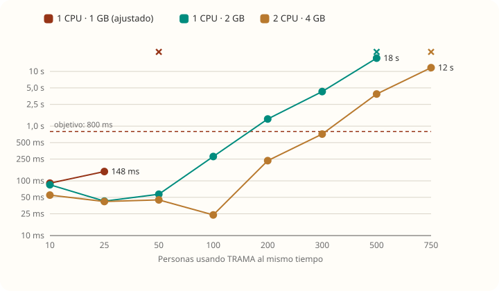
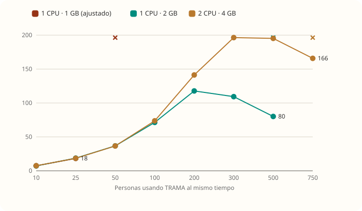
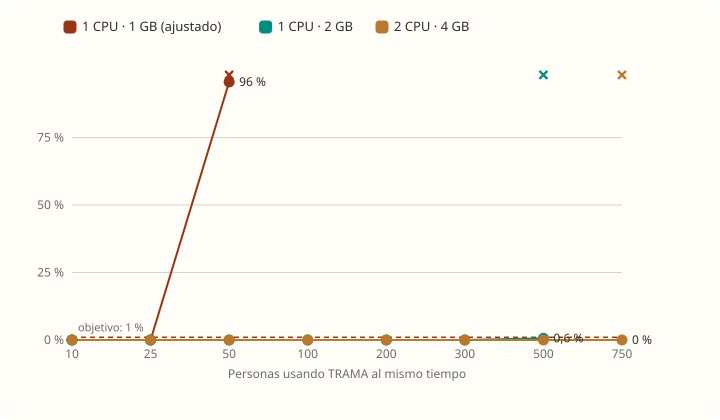

### Lo que muestran las tablas

- **La memoria nunca fue el límite** en 2 GB y 4 GB: el backend usó como máximo 601 MB de 1.128 y 693 MB de 2.416. El límite siempre es la **CPU**.
- **Pasado el techo, el servidor atiende menos, no más.** En 1 CPU · 2 GB, de 118 pedidos/s con 200 usuarios baja a 80 con 500: gasta más tiempo repartiéndose entre pedidos que atendiéndolos.
- **La mediana se mantiene baja mucho después de que el p95 se dispara.** La mayoría de los pedidos sigue rápida y unos pocos esperan muchísimo: es el síntoma de una **cola**, no de un sistema parejamente lento (ver la cadena de saturación).

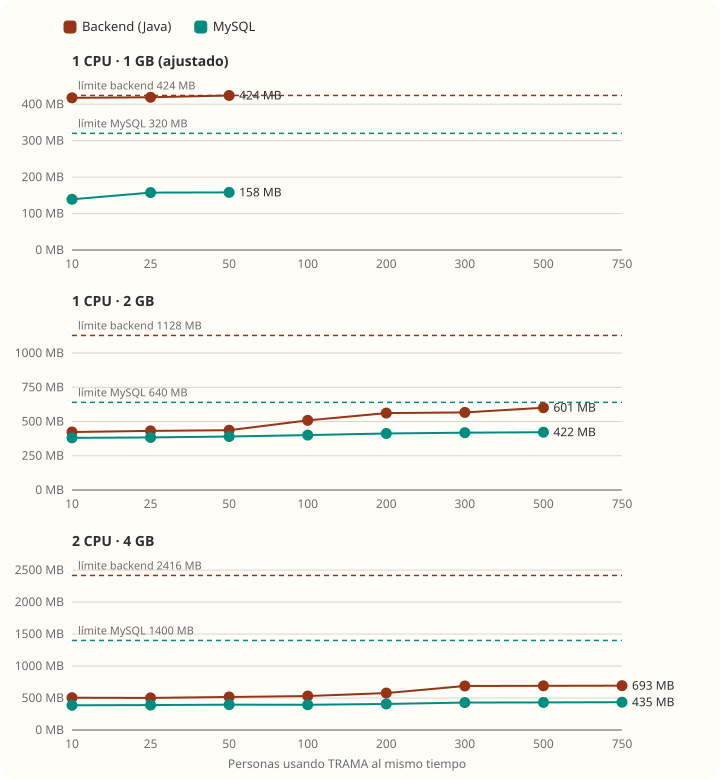
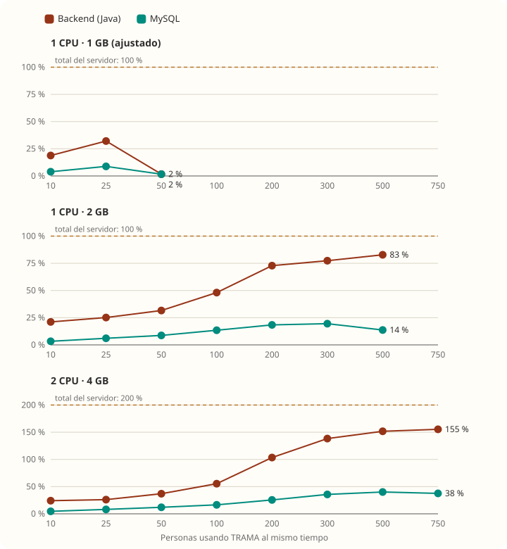
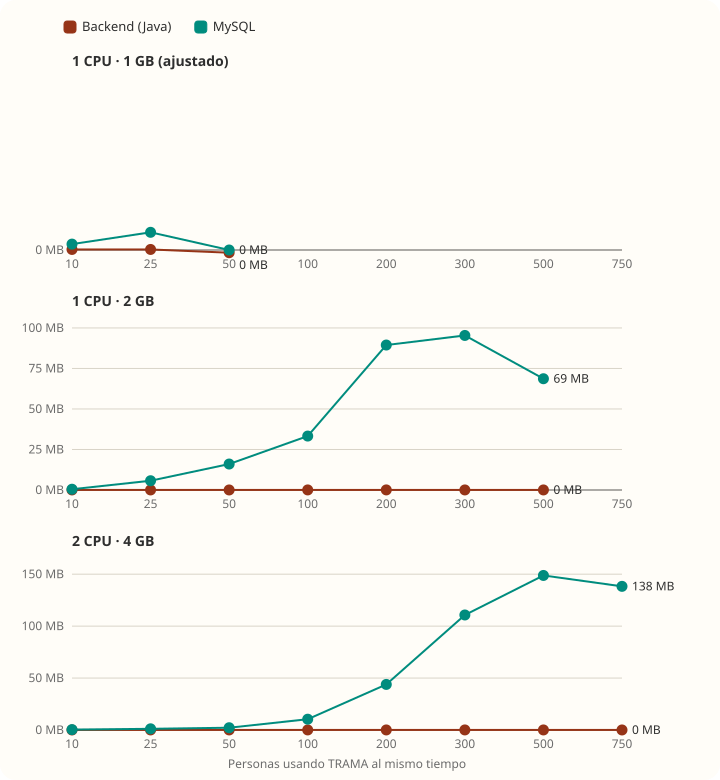

## Variante "login una vez"

| Usuarios | 2 GB con re-login | 2 GB login una vez | 4 GB con re-login | 4 GB login una vez |
|---|---|---|---|---|
| 100 | 279 ms · 71/s | 186 ms · 70/s | 24 ms · 74/s | 14 ms · 74/s |
| 200 | 1,4 s · 118/s | 832 ms · 128/s | 234 ms · 141/s | 65 ms · 146/s |
| 300 | 4,3 s · 109/s | 1,8 s · **162/s** | 716 ms · 196/s | 523 ms · 202/s |
| 500 | 17,5 s · 80/s | 13,6 s · 117/s | 3,9 s · 195/s | 1,7 s · **282/s** |
| 750 | — | — | 11,7 s · 166/s | 7,6 s · 242/s |

Sacando los re-logins el techo sube un **37 %** en 2 GB y un **44 %** en 4 GB. Aun así, cada escalón empieza con todos los usuarios entrando en los mismos 10 segundos: eso es lo que pasaría **a la hora de entrada a la escuela**, y es lo que termina saturando.

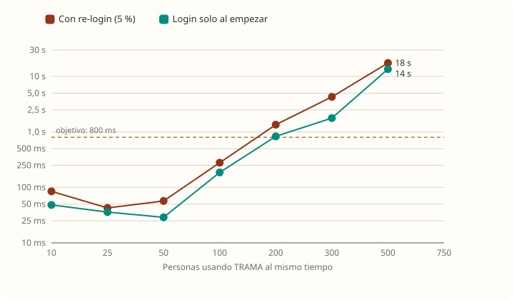
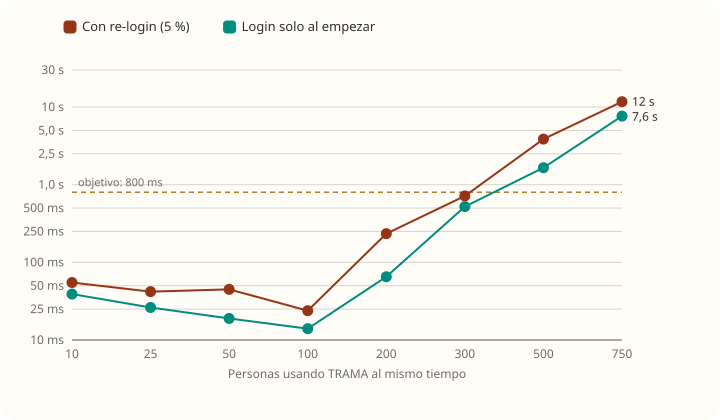

## Qué satura a TRAMA

Grabaciones de Java Flight Recorder durante un minuto de saturación:

| Medición | 2 GB · 200 usuarios | 2 GB · 400 | 4 GB · 300 | 4 GB · 600 |
|---|---|---|---|---|
| CPU en **BCrypt** | 57 % | **75 %** | 78 % | 75 % |
| CPU en Hibernate + driver MySQL | 23 % | 13 % | 10 % | 12 % |
| Veces que un pedido esperó una conexión | 7.921 | 6.527 | 18.065 | 15.633 |
| **Tiempo total esperando conexión** | 6.070 s | **10.671 s** | 8.409 s | 11.150 s |
| Espera más larga | 1,4 s | 5,8 s | 0,8 s | 1,1 s |
| Pausa más larga del recolector de basura | 174 ms | 159 ms | 25 ms | 27 ms |

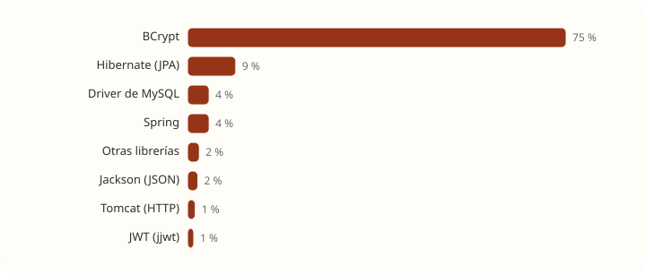
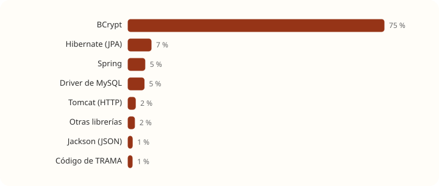

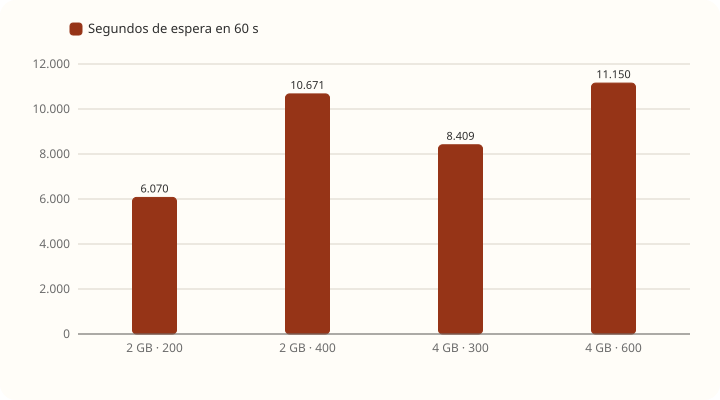

**La cadena:**

1. **BCrypt** cuesta alrededor de 100 ms de CPU por login, a propósito: es lo que hace difícil adivinar contraseñas. Con muchos logins se come la CPU.
2. TRAMA no configura `spring.jpa.open-in-view`, así que queda **activado** (el propio backend lo avisa al arrancar). Con eso, `AuthenticationService.authenticate` busca al usuario, **toma una conexión y no la suelta hasta terminar el pedido**, incluido el cálculo de BCrypt.
3. Hikari tiene **10 conexiones** (valor por defecto). Con la CPU saturada, BCrypt tarda más y las conexiones quedan tomadas más tiempo. **Todos** los pedidos —no solo los logins— esperan una conexión libre. En 60 segundos se acumularon más de 10.000 segundos de espera: en promedio, unos 170 pedidos parados a la vez.
4. Cuando la espera pasa los 30 s, Hikari corta con `Connection is not available, request timed out after 30000ms` y la persona recibe `500`.

**Factores que suman:**

- **Filtro JWT en cada pedido.** `JwtAuthenticationFilter` parsea y verifica la firma del token tres veces (`extractUsuarioId`, `isTokenValid` → `extractUsuarioId` e `isTokenExpired`) y busca al usuario en la base. Es entre el 11 % y el 24 % de la CPU de cada pedido.
- **Unas 27 consultas SQL por pedido.** Con 200 usuarios en 2 GB hubo 202.345 consultas para 7.353 pedidos. Las principales: adjuntos de cada aporte (58.658 veces, problema N+1), membresía del usuario (33.261 veces: los permisos se verifican unas 4,5 veces por pedido) y el usuario del filtro JWT (10.687).
- **Recolector de basura Serial en 1 CPU.** Con menos de 2 CPU o menos de ~1,8 GB, Java elige el recolector *Serial*, que detiene la aplicación entera mientras limpia: pausas de hasta 174 ms. Con 2 CPU usa G1 y las pausas bajan a 27 ms.

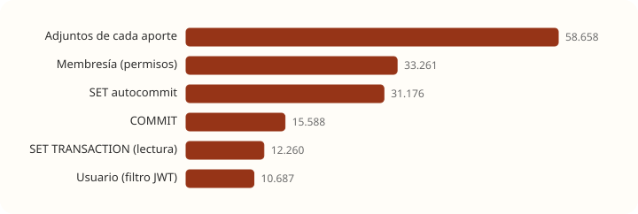

**MySQL no es el cuello de botella.** Ninguna consulta tardó en promedio más de 0,2 ms, el 99,9 % de las lecturas salió de memoria, no hubo esperas por bloqueos de filas ni consultas lentas. El costo está del lado de Java, en hacer tantos viajes.

## Costo de cada flujo

Cada flujo solo, sin saturar, en 1 CPU · 2 GB:

| Flujo | p95 | Memoria pedida por pedido | Qué usa la CPU |
|---|---|---|---|
| Iniciar sesión | 117 ms | 606 KB | **BCrypt 98 %** |
| Inicio (mis niños) | 23 ms | 730 KB | Filtro JWT 24 %, Tomcat 23 %, proyectos 21 % |
| Ver aportes (20 aportes) | 29 ms | 2,1 MB | Aportes 40 %, permisos 13 %, filtro JWT 12 % |
| Bitácora | 33 ms | 2,8 MB | Aportes 40 %, permisos 12 %, filtro JWT 11 % |
| Cargar aporte | 27 ms | 946 KB | Filtro JWT 24 %, Tomcat 21 %, aportes 16 % |
| Editar aporte | 31 ms | 1,2 MB | Tomcat 28 %, aportes 24 %, filtro JWT 17 % |
| Subir archivo de 1 MB | 97 ms | 6 MB | Tomcat 69 % (leer el archivo), permisos 8 % |

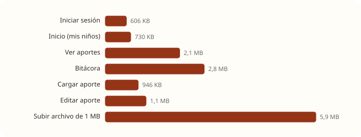

**Por qué cada uno pesa lo que pesa:**

- **Ver aportes y bitácora** son los más pesados en memoria aunque el niño tenga solo 20 aportes: por cada aporte se descifra el contenido y los datos, se hace una consulta de adjuntos y se arma la respuesta JSON completa. Ese costo crece **en proporción a la cantidad de aportes**, y por eso es el límite real (ver [casos-limite.md](casos-limite.md#niños-con-muchos-aportes)).
- **Subir un archivo** pide unas 6 veces su tamaño: Tomcat lo recibe, `getBytes()` lo copia, `cifrar` hace otra copia y escribir en disco usa un buffer más.
- **El filtro JWT** aparece en todos: es un costo fijo por pedido que pesa más en los flujos livianos (inicio, cargar).
- Toda esta memoria es temporal. El heap usado nunca pasó de 88 MB en estos flujos; lo que crece es el trabajo del recolector de basura.

## Prueba larga (20 minutos, 100 usuarios)

| Servidor | p95 | Errores | Pedidos | RAM del backend |
|---|---|---|---|---|
| 1 CPU · 2 GB | 87 ms | 0 % | 90.556 | de 528 a 553 MB (+25 MB) |
| 2 CPU · 4 GB | 33 ms | 0 % | 92.027 | estable en 553 MB |

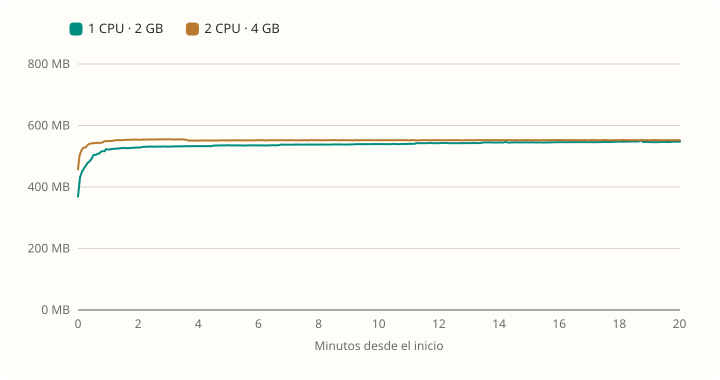

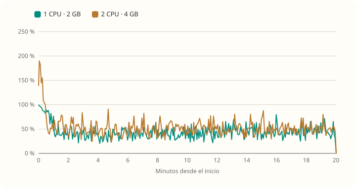

**No se detectó fuga de memoria.** La leve suba en 2 GB coincide con los aportes que se van cargando durante la prueba, que hacen cada lista un poco más grande. Antes de producción conviene una prueba de varias horas.

## Resiliencia: MySQL se cae con gente usando la app

| Servidor | MySQL apagado | El login vuelve a funcionar | Errores (de ~7.600 pedidos) |
|---|---|---|---|
| 1 CPU · 2 GB | 33 s | 9 s después de prender MySQL | 0,8 % |
| 2 CPU · 4 GB | 34 s | 8 s después de prender MySQL | 0,8 % |

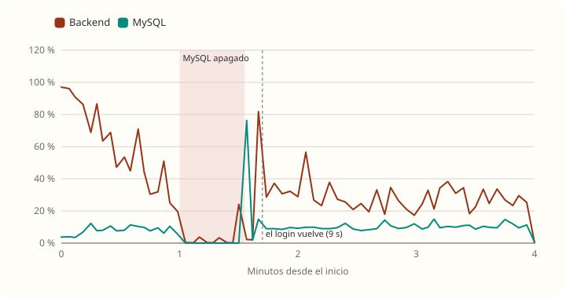

TRAMA **se recupera sola**, sin reiniciar el backend. Hubo pocos errores porque, sin base, los pedidos **se quedan esperando** una conexión (hasta 30 s) en lugar de fallar al instante: para la persona, la app parece colgada durante el corte. Los errores fueron `Communications link failure` en las conexiones abiertas justo en el momento del corte.

## Arranque

| Servidor | Tiempo hasta responder | RAM del backend sin uso | RAM de MySQL sin uso |
|---|---|---|---|
| 1 CPU · 2 GB | 11 s | 350 MB | 374 MB |
| 2 CPU · 4 GB | 8 s | 573 MB | 381 MB |

Java toma un tamaño de heap proporcional al límite del contenedor (25 % por defecto), por eso el backend ocupa más con más memoria disponible.
