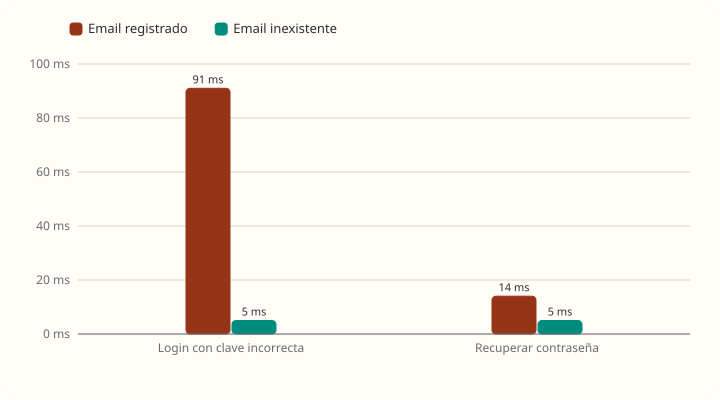
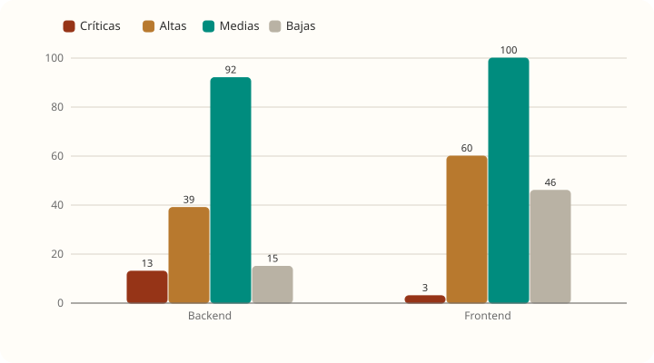

# Seguridad

[← Volver al resumen](README.md) · Cómo arreglarlas: [remediacion.md](remediacion.md)

Revisión del código, la configuración y las dependencias de `develop`. Lo marcado como **verificado** se comprobó con pedidos reales contra el entorno de pruebas; el resto sale de leer el código.

## Lo que está bien

Antes de los problemas, lo que conviene mantener:

- Todo lo que no está declarado en `SecurityConfig` se **deniega** (`anyRequest().denyAll()`), y de Actuator solo se expone `/health`.
- Contraseñas con **BCrypt**, clave del JWT por variable de entorno, sesiones sin estado.
- El filtro JWT revisa que la cuenta siga **habilitada y no bloqueada** en cada pedido.
- **Bloqueo de cuenta** tras 5 intentos fallidos durante 15 minutos.
- `/recuperar` responde **siempre el mismo mensaje**, exista o no el email.
- Archivos adjuntos y datos sensibles **cifrados** (AES); claves de cifrado en OpenBao.
- Las ediciones simultáneas **no corrompen datos**: cada edición exitosa deja su versión (ver [casos-limite.md](casos-limite.md#ediciones-simultáneas)).

## Código

| # | Hallazgo | Gravedad | Evidencia |
|---|---|---|---|
| C1 | **Se puede saber si un email está registrado** | Media | **Verificado.** Login con contraseña incorrecta: 91 ms si el email existe y 5 ms si no (no hace BCrypt). Después de 5 intentos el mensaje cambia a `CUENTA_BLOQUEADA` solo si el email existe. `/recuperar`: 14 ms contra 5 ms (con Gmail, segundos de diferencia, porque el mail se envía dentro del pedido) |
| C2 | **Sin límite de pedidos por IP** en `/api/auth/*` | Media-alta | **Verificado.** Con 80 logins por segundo el backend quedó sin responder ([casos-limite.md](casos-limite.md#tormenta-de-logins)). Además permite bloquear la cuenta de cualquier persona 15 minutos con 5 intentos (y repetirlo), y disparar mails de registro y recuperación sin freno (agota el cupo de Gmail) |
| C3 | **Errores inesperados sin registrar** | Media | **Verificado.** `GlobalExceptionHandler.handleUnexpected` devuelve `500` sin escribir la excepción en el log. Los 806 `OutOfMemoryError` de las subidas solo se vieron con Java Flight Recorder |
| C4 | **Título del aporte sin cifrar** | Media | `aporte.titulo` y `aporte_version.titulo` no usan `CifradoConverter`. Un título como "Crisis en el recreo" es texto libre sobre el niño; la regla del repo pide cifrarlo |
| C5 | **El JWT sigue valiendo 8 h aunque cambie la contraseña** | Media-baja | No hay lista de revocación ni se compara la fecha del token con la del último cambio de contraseña. Si alguien roba una sesión, restablecer la contraseña no la corta |
| C6 | **Contraseñas de más de 72 bytes** | Baja | Spring Security 6.1.9 tiene CVE-2025-22228: BCrypt solo compara los primeros 72 bytes. `RegisterRequest` no pone un largo máximo a la contraseña |
| C7 | **Código de recuperación adivinable con paciencia** | Baja | 6 dígitos, 5 intentos por código y un código nuevo por minuto: ~7.200 intentos por día y cuenta (~0,7 % de acertar por día). Se combina con C2 |
| C8 | **Tipo de archivo según lo que declara el navegador** | Baja | `ArchivoService` valida extensión y `Content-Type` declarado, no el contenido real del archivo. La foto de perfil se sirve sin `X-Content-Type-Options: nosniff` (el comprobante sí lo tiene) |
| C9 | **Mails dentro del pedido** | Baja (rendimiento) | No hay `@Async`: registro, invitaciones, recuperación y avisos esperan a Gmail. Un Gmail lento frena esos pedidos y retiene su conexión a la base |

**Qué haría:**

- **C1:** responder igual con email inexistente, ejecutando BCrypt contra un hash fijo; mismo mensaje para cuenta bloqueada e inexistente; mails en segundo plano.
- **C2:** límite por IP y por email en `/api/auth/*`. Se puede hacer en nginx (`limit_req`) sin dependencias nuevas.
- **C3:** registrar la excepción en `handleUnexpected` (sin datos del niño).
- **C4:** cifrar el título. Es un cambio de esquema: migración Flyway y migrar los títulos existentes. Para decidir con el equipo.
- **C5:** guardar la fecha del último cambio de contraseña y rechazar tokens emitidos antes.
- **C6:** `@Size(max = 72)` en la contraseña y actualizar Spring Security.
- **C8:** validar los primeros bytes del archivo (PNG, JPEG, PDF) y agregar `nosniff` a la foto.

## Configuración y despliegue

| # | Hallazgo | Gravedad | Evidencia |
|---|---|---|---|
| D1 | **MySQL y el backend publicados en todas las interfaces** | Alta (en un VPS) | `docker-compose.yml`: `"3307:3306"` y `"4002:8080"`. En un servidor con IP pública quedan abiertos a internet: Docker escribe sus propias reglas de firewall y se saltea `ufw` |
| D2 | **Demo pública con cuentas de contraseña conocida** | Alta (en la demo) | `backend-demo` corre con `SPRING_PROFILES_ACTIVE: dev`, que activa `DataSeeder`: crea `tutor@trama.test`, `docente@trama.test` y otras con la contraseña fija `Trama1234!`. La demo está publicada por ngrok |
| D3 | **Logs de Docker sin rotación** | Media (operación) | Ningún servicio configura `logging`: los logs crecen hasta llenar el disco |
| D4 | **Contenedores corriendo como root** | Baja | Ningún `Dockerfile` usa `USER` |
| D5 | **nginx sin cabeceras de seguridad** | Baja | `nginx.conf.template` no agrega `Content-Security-Policy`, `X-Frame-Options`, `Referrer-Policy` ni oculta la versión (`server_tokens off`) |
| D6 | **Backups sin rotación** | Media (operación) | Ver [capacidad-50gb.md](capacidad-50gb.md#backups) |

**Qué haría:**

- **D1:** `"127.0.0.1:3307:3306"` y `"127.0.0.1:4002:8080"`, como ya hacen Mailpit, OpenBao y la demo.
- **D2:** un perfil `demo` sin `DataSeeder`, o que el seeder solo corra con una variable explícita.
- **D3:** `logging.options.max-size` y `max-file` en cada servicio.
- **D4:** `USER` sin privilegios en los `Dockerfile`.
- **D5:** agregar las cabeceras en nginx.

## Dependencias (Trivy)

Escaneo de las imágenes con Trivy 0.57.1, que descargó su base de vulnerabilidades al momento del escaneo (6 de noviembre de 2026):

| Imagen | Críticas | Altas | Medias | Bajas |
|---|---|---|---|---|
| `trama-backend` (Ubuntu 26.04 + Java) | **13** | 39 | 92 | 15 |
| `trama-frontend` (nginx 1.27 sobre Alpine 3.21.3) | 3 | 60 | 100 | 46 |

### Backend

La causa de fondo es **Spring Boot 3.1.11, que ya no tiene soporte gratuito**. Arrastra versiones viejas de Tomcat (10.1.20), Spring Framework (6.0.19), Spring Security (6.1.9) y Jackson (2.15.4).

| Componente | CVE | ¿Aplica a TRAMA? |
|---|---|---|
| Spring Security 6.1.9 | CVE-2025-22228 (BCrypt y 72 bytes) | **Sí**, ver C6 |
| Tomcat 10.1.20 | CVE-2025-48988 (DoS en subidas *multipart*) | **Sí**: TRAMA acepta subidas |
| Tomcat 10.1.20 | CVE-2024-38286, CVE-2025-52520, CVE-2025-53506, CVE-2026-41284 (denegación de servicio) | **Probablemente sí** |
| Tomcat 10.1.20 | CVE-2025-24813 (escritura parcial con PUT) | No: el servlet por defecto de Spring Boot es de solo lectura |
| Tomcat 10.1.20 | CVE-2026-41293, CVE-2025-48989 y otras de HTTP/2 | No: Spring Boot no habilita HTTP/2 por defecto |
| Tomcat 10.1.20 | CVE-2026-43512, CVE-2026-68525 y otras de autenticación FORM o *digest* | No: TRAMA usa JWT |
| Tomcat 10.1.20 | CVE-2024-50379 / CVE-2024-56337 (JSP en sistemas de archivos sin distinción de mayúsculas) | No: no hay JSP y corre en Linux |
| Tomcat 10.1.20 | CVE-2026-65182 (evasión de restricciones de seguridad) | **A revisar** |
| Spring Framework 6.0.19 | CVE-2026-47884 (ejecución remota en `spring-webmvc`) | **A revisar.** Trivy la marca crítica para esta versión; no pude verificar las condiciones exactas |
| Spring Security 6.1.9 | CVE-2026-22732 (evasión de políticas) | **A revisar** |
| Spring Security 6.1.9 | CVE-2024-38821 | No: solo afecta a WebFlux |
| Spring Framework 6.0.19 | CVE-2024-38816 / CVE-2024-38819 (*path traversal*) | No: solo con `RouterFunctions` y recursos estáticos |
| Spring Boot 3.1.11 | CVE-2025-22235 (`EndpointRequest.to()`) | No: no se usa |
| Jackson 2.15.4 | Varias de deserialización polimórfica | Probablemente no: TRAMA no activa *default typing*. Las de denegación de servicio sí podrían aplicar |
| BouncyCastle 1.73 | CVE-2025-14813, CVE-2026-8763, CVE-2026-5598 | **A revisar** qué dependencia la trae y si se usa |
| snakeyaml 1.33 | CVE-2022-1471 | No: solo se leen los YAML propios |
| mysql-connector-j 8.0.33 | CVE-2023-22102 | No en la práctica: requiere un servidor MySQL malicioso |

**Qué haría:** actualizar Spring Boot a una versión con soporte. Resuelve casi todas de una vez. Como son cambios de versión mayores, conviene una rama propia con todos los tests (`./mvnw test`) y repetir estas pruebas de carga.

### Frontend

Las 3 críticas y la mayoría de las altas son paquetes de Alpine 3.21.3 dentro de `nginx:1.27-alpine`: OpenSSL (la crítica solo afecta a sistemas de 32 bits), brotli, curl y c-ares. **Se resuelven reconstruyendo con una imagen base de nginx actualizada**, sin tocar código.

`npm audit` sobre las dependencias de producción marca además `follow-redirects` (alta), que viene con axios. En el navegador axios no lo usa, así que el riesgo real es bajo, pero se arregla con `npm audit fix`.
